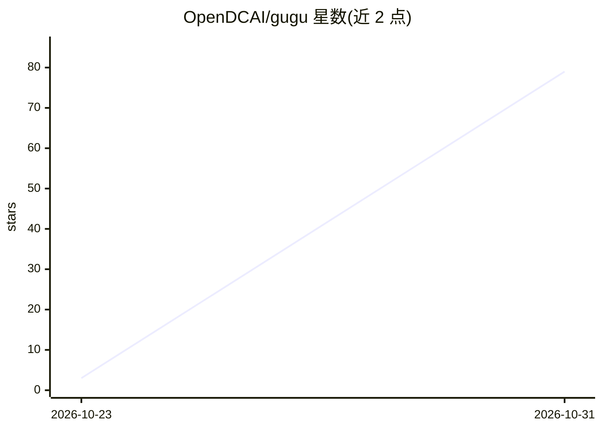

# OpenDCAI/gugu

⭐ 79 · TypeScript · NOASSERTION · 推送 2026-10-30 · [GitHub](https://github.com/OpenDCAI/gugu) · [官网](https://gugu.nextmind.space) · 组织维护 · 中文 README

**人与 AI Agent 协同聊天的个人助理客户端**

Gugu 是一个聊天客户端，让人与 AI Agent 在同一群组中协作：可像同事一样给 Agent 派活，Agent 也可将任务拆分给其他并行运行的 Agent。支持跨设备运行（本机、SSH 远程机器、手机）、Agent 搭建群组应用，以及 Browser Use / Computer Use 执行网页与桌面操作。模型凭据由用户自带，可接入 Claude Code、Codex 等已有订阅。自托管需 Node、pnpm 与独立 Supabase 项目，桌面端与 Android 提供下载。

## 筛选速览

| 维度 | 判定 | 备注 |
|---|---|---|
| AI 角色 | `ai-native` | 本体是模型或模型工具 |
| 许可风险 | `none` | NOASSERTION |
| 部署形态 | `library` | 以包/库形式分发 |
| 模型依赖 | — | README 未给出锁定关系 |
| 硬件要求 | — | 无带数字的原话,不猜 |
| 安装摩擦 | `low` | 无编译、无系统依赖或容器化 |
| 成熟度 | — | 结构信号不足 |

## 能力要点

- 人与 Agent 同群协作、任务拆分与多 Agent 并行
- 跨设备：本机 + SSH 远程机器 + 手机跟进
- Agent 可构建群组应用，人与 Agent 共享数据
- 自带模型凭据，可使用 Claude Code / Codex 订阅

## 适用场景

- 把 AI Agent 当同事，在群里讨论并分配工作
- 多设备跟踪 Agent 任务进度
- 让 Agent 操作浏览器与桌面完成任务

## 场景标签

`多智能体` `GUI 自动化` `AI 助手` `浏览器自动化` · 领域:Agent 开发

## 证据(README 行号)

> L5: Gugu is a chat client where people and AI Agents work together. Give Agents work the way you would a coworker, discu
> L11: - **Keep your model credentials**: use Agents such as Claude Code and Codex with existing subscriptions or your own

## 星数曲线

2026-10-23 3 → 2026-10-31 79（+76）

---
*卡片 v1 · prompt 1.4 · 生成 2026-10-30 · 置信度 mid · 依据 README sha `013d329f803a` · [字段定义](../../DATASET.md)*
