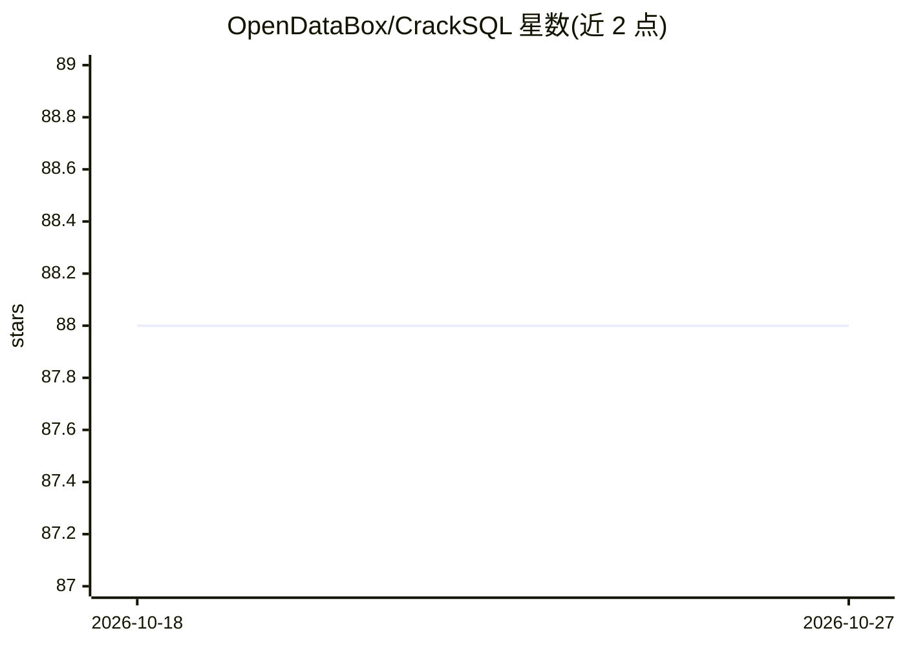

# OpenDataBox/CrackSQL

⭐ 88 · Python · MIT · 推送 2026-03-08 · [GitHub](https://github.com/OpenDataBox/CrackSQL) · [官网](https://dl.acm.org/doi/10.1145/3725278) · 组织维护 · 中文 README

**面向数据库迁移场景的 SQL 方言翻译系统（规则+LLM 混合）**

CrackSQL 是一个 SQL 方言翻译工具，结合 SQLGlot 规则与大语言模型，支持 PostgreSQL、MySQL、Oracle 之间的转换，提供 Rule-only、LLM-direct、Rule+LLM 三种模式，可通过 Python API、命令行和 Web 界面使用。LLM 与 Embedding 模型支持云端（如 GPT 系列）及 Hugging Face 本地部署。Rule+LLM 模式使用 ANTLR 语法解析器与方言功能规格，配合数据库连接与向量知识库（初始化需 Embedding 模型）。翻译耗时依赖 SQL 复杂度，可从数秒到数分钟。可通过修改 ANTLR .g4 文件与 JSON 规格扩展新语法和新方言。

## 筛选速览

| 维度 | 判定 | 备注 |
|---|---|---|
| AI 角色 | `ai-native` | 本体是模型或模型工具 |
| 许可风险 | `permissive` | MIT |
| 部署形态 | `library` | 以包/库形式分发 |
| 模型依赖 | — | README 未给出锁定关系 |
| 硬件要求 | — | 无带数字的原话,不猜 |
| 安装摩擦 | `low` | 无编译、无系统依赖或容器化 |
| 成熟度 | — | 结构信号不足 |

## 能力要点

- 三种翻译模式（Rule-only / LLM-direct / Rule+LLM），Rule-only 覆盖 24 种方言
- 支持云端与本地部署的 LLM 及 Embedding 模型（含微调）
- Python API、命令行与 Web 界面三种接入方式
- 通过 ANTLR 语法文件与 JSON 方言规格扩展新方言

## 适用场景

- 数据库迁移时把 PostgreSQL/MySQL/Oracle 的 SQL 互相转换
- 作为 Python 库或命令行工具嵌入数据处理流程做批量 SQL 翻译
- 通过 Web 界面交互式查看翻译过程与结果

## 场景标签

`代码生成` · 领域:编码与开发

## 证据(README 行号)

> L24: CrackSQL is a powerful SQL dialect translation tool that integrates rule-based strategies with LLMs for high accura
> L40: Currently, CrackSQL has integrated three modes for dialect translation, adopting the rules from SQLGlot and support
> L61:  ✅

## 星数曲线

2026-10-18 88 → 2026-10-27 88（+0）

---
*卡片 v1 · prompt 1.4 · 生成 2026-10-23 · 置信度 high · 依据 README sha `a126b3a53c25` · [字段定义](../../DATASET.md)*
