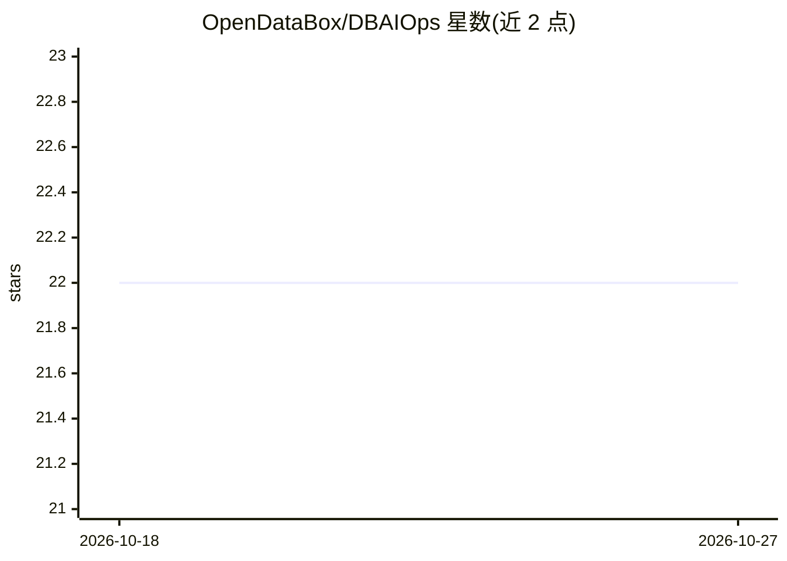

# OpenDataBox/DBAIOps

⭐ 22 · JavaScript · Apache-2.0 · 推送 2026-04-20 · [GitHub](https://github.com/OpenDataBox/DBAIOps) · [官网](https://www.vldb.org/pvldb/vol19/p1319-zhou.pdf) · 组织维护 · 中文 README

**面向 DBA 的浏览器扩展：LLM 增强的数据库问答与运维分析**

VLDB 2026 论文配套的浏览器扩展（Chromium MV3），面向数据库工程师与 DBA。以知识图谱为知识底座，提供四类工作流：数据库知识问答（SQL 语法、排障、调优）、Oracle AWR 报告上传后的结构化 AI 分析、巡检任务与历史记录审阅、SQL 优化与脱敏。模型通过浏览器端配置接入 OpenAI 兼容端点（含本地 Ollama 示例），需配置注册信息、知识服务 URL 与 API key。以加载未打包扩展方式安装，仓库保留打包产物与演示视频。

## 筛选速览

| 维度 | 判定 | 备注 |
|---|---|---|
| AI 角色 | `ai-native` | 本体是模型或模型工具 |
| 许可风险 | `permissive` | Apache-2.0 |
| 部署形态 | `None` |  |
| 模型依赖 | local-ok | 支持本地模型 |
| 硬件要求 | — | 无带数字的原话,不猜 |
| 安装摩擦 | `low` | 无编译、无系统依赖或容器化 |
| 成熟度 | — | 结构信号不足 |

## 能力要点

- 知识图谱支撑的数据库知识问答（语法/排障/调优/最佳实践）
- Oracle AWR HTML 报告（单实例与 RAC）上传后的 AI 辅助分析
- SQL 优化任务与报告脱敏模块
- 模型提供方在浏览器端配置，支持 OpenAI 兼容端点（含本地 Ollama 示例）

## 适用场景

- 作为 DBA 日常问答助手查询数据库知识与排障经验
- 上传 Oracle AWR 报告获取结构化性能分析
- 审阅周期性巡检任务的摘要与异常项并复查历史记录
- 提交 SQL 获取优化建议并脱敏报告中的敏感语句

## 场景标签

`聊天机器人` `文档问答` · 领域:对话与助手

## 证据(README 行号)

> L7:  🚀 Browser-based assistant for knowledge-grounded Q&A, AWR report analysis, inspection review, and SQL optimization.
> L47: |Knowledge Q&A|Query database knowledge bases for SQL syntax, troubleshooting, tuning, and best practices|
> L50: |SQL Optimization|Submit SQL optimization tasks and inspect returned recommendations|

## 星数曲线

2026-10-18 22 → 2026-10-27 22（+0）

---
*卡片 v1 · prompt 1.4 · 生成 2026-10-27 · 置信度 high · 依据 README sha `96c0d78334d5` · [字段定义](../../DATASET.md)*
