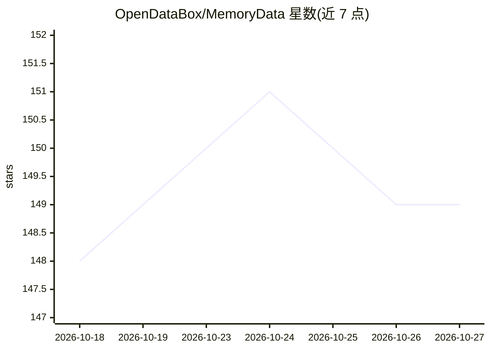

# OpenDataBox/MemoryData

⭐ 149 · Python · 推送 2026-07-05 · [GitHub](https://github.com/OpenDataBox/MemoryData) · [官网](https://arxiv.org/abs/2606.24775) · 组织维护 · 中文 README

**记忆增强 Agent 的统一基准评测套件**

面向科研的基准评测套件，将 MemoryAgentBench、LoCoMo、LongBench、MemBench 四个基准家族与 22 个方法预设（长上下文/Embedding RAG/BM25 等 Reference 基线、Mem0/Cognee/Zep 等结构化记忆方法）统一到单一 main.py 启动器下，用两个 YAML 指定方法与数据集即可运行并输出结果 JSON 与持久化 agent 状态。需 Python 3.11 与 OpenAI 兼容模型端点，数据集需自行放置于 datasets/ 目录且不随仓库分发；Linux/macOS 与 Windows 使用不同依赖清单。

## 筛选速览

| 维度 | 判定 | 备注 |
|---|---|---|
| AI 角色 | `ai-ecosystem` | LLM/agent 周边工具 |
| 许可风险 | `none` | — |
| 部署形态 | `library` | 以包/库形式分发 |
| 模型依赖 | — | README 未给出锁定关系 |
| 硬件要求 | — | 无带数字的原话,不猜 |
| 安装摩擦 | `low` | 无编译、无系统依赖或容器化 |
| 成熟度 | — | 结构信号不足 |

## 能力要点

- 单一 main.py 入口统一 4 个基准家族与 22 个方法预设
- 按范式分类的方法清单（Reference/Sequential/Topological/Hybrid）
- 每次运行产出结果 JSON、持久化 agent 状态与日志，存放于可覆盖的 results/ 目录
- Linux/macOS 与 Windows 提供独立依赖清单

## 适用场景

- 在同一执行接口下对比不同记忆增强方法的评测结果
- 复现论文中方法间的对比数据
- 对新记忆方法在既有基准上做标准化评测

## 场景标签

`模型评测` `科研工具` · 领域:评测与运维

## 证据(README 行号)

> L37: **MemoryData closes that gap.** It is a research-oriented benchmark suite that unifies four benchmark families (Mem
> L143: |Group|Method|Representative preset|Runtime entry|Notes|

## 星数曲线

2026-10-18 148 → 2026-10-27 149（+1）

---
*卡片 v1 · prompt 1.4 · 生成 2026-10-23 · 置信度 mid · 依据 README sha `278e568a2453` · [字段定义](../../DATASET.md)*
