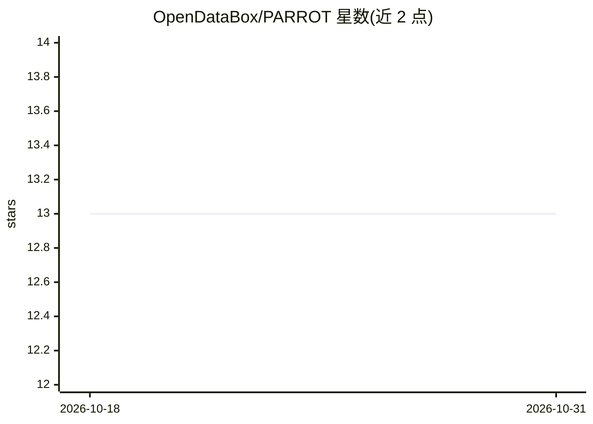

# OpenDataBox/PARROT

⭐ 13 · Python · 推送 2025-11-11 · [GitHub](https://github.com/OpenDataBox/PARROT) · [官网](https://code4db.github.io/parrot-bench/) · 组织维护

**跨系统 SQL 方言翻译的评测基准（598 对翻译样本）**

面向 LLM 跨数据库系统 SQL 翻译评测的基准数据集：PARROT-1.0 收录 28,003 个翻译对、598 个精选翻译对，来源覆盖 38+ 公开基准与生产衍生工作负载，支持 PostgreSQL、MySQL、Oracle、Snowflake 等 10+ 种 SQL 方言。提供语法有效性与执行结果等价性的多维评分、内置校验器与解析器，配套在线排行榜与月度提交规则。相关论文被 NeurIPS 2025 接收，由上海交通大学、清华大学与字节跳动团队制作。

## 筛选速览

| 维度 | 判定 | 备注 |
|---|---|---|
| AI 角色 | `ai-knowledge` | 知识聚合/清单类 |
| 许可风险 | `none` | — |
| 部署形态 | `None` |  |
| 模型依赖 | — | README 未给出锁定关系 |
| 硬件要求 | — | 无带数字的原话,不猜 |
| 安装摩擦 | `low` | 无编译、无系统依赖或容器化 |
| 成熟度 | — | 结构信号不足 |

## 能力要点

- 598 个精选翻译对，来自 38+ 公开基准与生产衍生负载
- 覆盖 10+ SQL 方言、15+ 执行引擎
- 语法有效性与执行等价性的多维评分及内置校验器
- 在线排行榜与结果提交流程

## 适用场景

- 评测我的 LLM 或翻译系统在 SQL 方言转换上的表现
- 为 SQL 翻译研究提供标准数据集与评分方案
- 通过排行榜对比不同系统的翻译能力

## 场景标签

`模型评测` · 领域:评测与运维

## 证据(README 行号)

> L13: **The first comprehensive benchmark for evaluating cross-system SQL translation systems**
> L19: > - **05/2025:** We have released PARROT-1.0 (28,003 translation pairs from 38 open-source benchmarks for extensive

## 星数曲线

2026-10-18 13 → 2026-10-31 13（+0）

---
*卡片 v1 · prompt 1.4 · 生成 2026-10-31 · 置信度 high · 依据 README sha `70a14fa2c437` · [字段定义](../../DATASET.md)*
