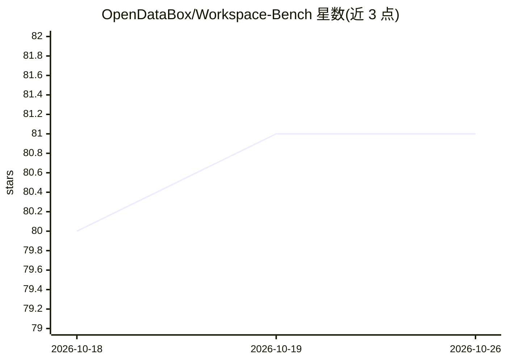

# OpenDataBox/Workspace-Bench

⭐ 81 · Python · MIT · 推送 2026-08-27 · [GitHub](https://github.com/OpenDataBox/Workspace-Bench) · [官网](https://workspace-bench.github.io) · 组织维护 · 中文 README

**评测 AI agent 在大规模文件依赖工作区任务上的基准**

Workspace-Bench 是评测 AI agent 在含大规模文件依赖的真实工作区任务上表现的基准：覆盖 5 种职业画像、74 种文件类型、20,476 个文件（工作区最大 20GB）、388 个任务与 7,399 条细粒度评分 rubric，并提供 100 任务的 Lite 子集（评测成本降低约 70%）。支持 codex/openclaw/deepagent/claudecode/deepseek-harness 等 agent harness 与多种模型，通过 Docker 隔离运行任务，用 Anthropic 兼容端点的 judge 模型按 rubric 打分，并提供中文版数据与结果可视化面板。

## 筛选速览

| 维度 | 判定 | 备注 |
|---|---|---|
| AI 角色 | `ai-ecosystem` | LLM/agent 周边工具 |
| 许可风险 | `permissive` | MIT |
| 部署形态 | `self-host` | docker 或自建部署 |
| 模型依赖 | locked-api |  |
| 硬件要求 | — | 无带数字的原话,不猜 |
| 安装摩擦 | `low` | 无编译、无系统依赖或容器化 |
| 成熟度 | — | 结构信号不足 |

## 能力要点

- 388 个任务，每个配显式文件依赖图，7,399 条细粒度 rubric
- 支持 codex/openclaw/deepagent/claudecode/deepseek-harness 五种 harness
- 任务级 Docker 隔离启动器（统一资源配额、逐任务新容器）
- 提供中文版数据集与 100 任务 Lite 子集

## 适用场景

- 评测自研 agent 在真实文件依赖工作区中的表现
- 对比不同 harness 与 backbone 模型的组合效果
- 用 Lite 子集低成本跑通评测流程

## 场景标签

`模型评测` · 领域:评测与运维

## 证据(README 行号)

> L33: Workspace-Bench is a benchmark for evaluating AI agents on **workspace tasks with large-scale file dependencies**. 
> L52: - **388** tasks, each paired with an explicit file dependency graph

## 星数曲线

2026-10-18 80 → 2026-10-26 81（+1）

---
*卡片 v1 · prompt 1.4 · 生成 2026-10-24 · 置信度 mid · 依据 README sha `50686ca18253` · [字段定义](../../DATASET.md)*
