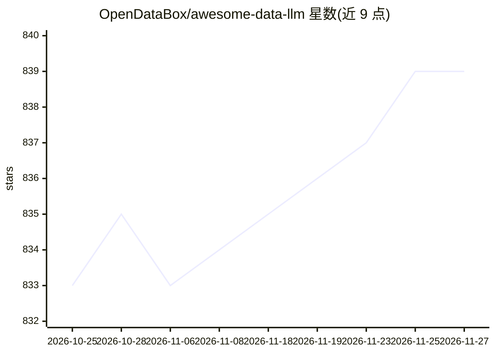

# OpenDataBox/awesome-data-llm

⭐ 839 · 推送 2026-10-25 · [GitHub](https://github.com/OpenDataBox/awesome-data-llm) · [官网](https://arxiv.org/pdf/2505.18458) · 组织维护 · 中文 README

**面向 LLM 研究者的数据集与数据处理论文集清单**

"LLM × DATA" 综述论文的官方仓库，收录与 LLM 相关的数据中心方法论文与项目。内容按数据集、LLM 各阶段数据（预训练、SFT、RLHF、RAG、评测、Agent）、数据获取、爬取工具等目录组织，每条附论文或数据集链接。中英双语 README，提供综述幻灯片与引用条目。自身不含代码与安装内容，仅作为文献与数据资源索引。

## 筛选速览

| 维度 | 判定 | 备注 |
|---|---|---|
| AI 角色 | `ai-knowledge` | 知识聚合/清单类 |
| 许可风险 | `none` | — |
| 部署形态 | `None` |  |
| 模型依赖 | — | README 未给出锁定关系 |
| 硬件要求 | — | 无带数字的原话,不猜 |
| 安装摩擦 | `low` | 无编译、无系统依赖或容器化 |
| 成熟度 | — | 结构信号不足 |

## 能力要点

- 收录 CommonCrawl、RedPajama、CCI 3.0 等预训练与微调数据集条目
- 按 LLM 生命周期阶段（预训练/SFT/RL/RAG/评测/Agent）组织论文
- 含数据获取来源与爬取工具（Beautiful Soup/Selenium/Playwright）清单
- 提供中英双语版本与综述幻灯片

## 适用场景

- 为 LLM 预训练或微调寻找公开数据集
- 调研数据中心方法的相关论文
- 搭建数据采集与处理流程时参考工具选型

## 场景标签

`精选清单` · 领域:学习与行业

## 证据(README 行号)

> L5: > A collection of papers and projects related to LLMs and corresponding data-centric methods. arXiv
> L41: ## Table of Contents

## 星数曲线

2026-10-25 833 → 2026-11-27 839（+6）

---
*卡片 v1 · prompt 1.4 · 生成 2026-11-24 · 置信度 high · 依据 README sha `ee203bebb63d` · [字段定义](../../DATASET.md)*
