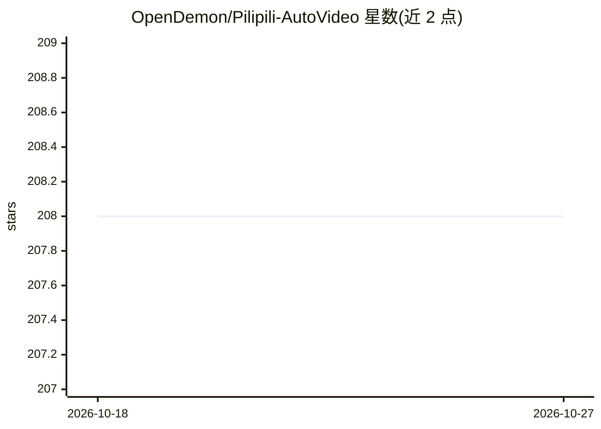

# OpenDemon/Pilipili-AutoVideo

⭐ 208 · Python · 推送 2026-03-25 · [GitHub](https://github.com/OpenDemon/Pilipili-AutoVideo) · 组织维护 · 中文 README

**本地部署的全自动 AI 视频代理：一句话生成带字幕成片**

端到端本地部署的 AI 视频生成流水线：输入一句话主题，系统经 LangGraph 编排完成剧本规划、Nano Banana 4K 关键帧生成、Kling 3.0/Seedance 1.5 图生视频、MiniMax TTS 配音（先测时长再定视频时长）、FFmpeg 合成与字幕烧录，输出 MP4 及剪映/CapCut 草稿工程。LLM 层支持 DeepSeek/Kimi/MiniMax/Gemini，通过 config.yaml 或 Web UI 设置页配置 API key。以 Python 3.10+ FastAPI 后端 + React 19 前端提供，CLI/Web UI/Docker Compose 三种运行方式，FFmpeg 为必需依赖。

## 筛选速览

| 维度 | 判定 | 备注 |
|---|---|---|
| AI 角色 | `ai-native` | 本体是模型或模型工具 |
| 许可风险 | `none` | — |
| 部署形态 | `self-host` | docker 或自建部署 |
| 模型依赖 | locked-api |  |
| 硬件要求 | — | 无带数字的原话,不猜 |
| 安装摩擦 | `low` | 无编译、无系统依赖或容器化 |
| 成熟度 | — | 结构信号不足 |

## 能力要点

- 先测 TTS 配音毫秒时长再控制视频时长，保持音画对齐
- Nano Banana 关键帧锁定 + Kling/Seedance 双引擎 I2V 生成
- Mem0 记忆系统学习用户风格偏好
- 输出 MP4 与剪映/CapCut 草稿工程，可被任意 AI Agent 以 Skill 调用

## 适用场景

- 输入一句话生成带配音和字幕的短视频成片
- 在剪映/CapCut 中对 AI 生成的草稿做人工精修
- 作为标准 Skill 接入其他 AI Agent 的自动化流程

## 场景标签

`视频生成` · 领域:内容生成

## 证据(README 行号)

> L18: **Pilipili-AutoVideo (噼哩噼哩)** is a fully local, end-to-end AI video agent. Describe your video in one sentence — th
> L30: - 🎨 **Premium Visual Quality**: Nano Banana keyframe lock + Kling 3.0 / Seedance 1.5 dual-engine, exceptional subje
> L47: |Brain (LLM)|DeepSeek / Kimi / MiniMax / Gemini|Script generation, scene breakdown, metadata|

## 星数曲线

2026-10-18 208 → 2026-10-27 208（+0）

---
*卡片 v1 · prompt 1.4 · 生成 2026-10-22 · 置信度 high · 依据 README sha `02c5157997b5` · [字段定义](../../DATASET.md)*
