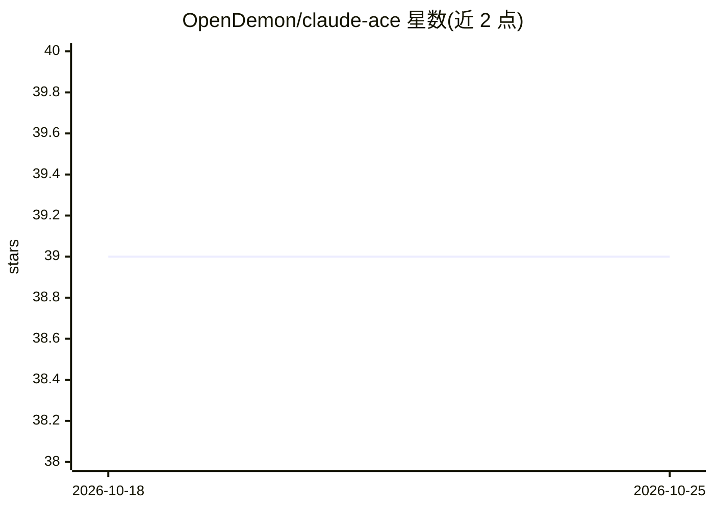

# OpenDemon/claude-ace

⭐ 39 · JavaScript · 推送 2026-04-01 · [GitHub](https://github.com/OpenDemon/claude-ace) · [官网](https://github.com/OpenDemon/claude-ace) · 个人维护 · 中文 README

**降低 Token 消耗的 AI 编程助手，兼容多模型 API**

以 Claude Code 源码为基线重构的命令行 AI 编程助手：用 Tree-sitter 提取 AST 骨架并按需展开以减少 Token 消耗，README 列出实测节约 56%-90% 的对照数据。支持任何兼容 OpenAI API 格式的模型接口，内置智谱 GLM、通义千问、DeepSeek、MiniMax、Kimi、OpenAI 的配置参考，首次启动有交互式配置向导，可用 /model 命令运行中切换模型。其他机制包括意图验证闭环、后台 Watchdog 运行 npm test 自动修复、跨项目持久记忆。需 Node.js >= 18 与兼容 OpenAI 格式的 API Key，从源码克隆运行。

## 筛选速览

| 维度 | 判定 | 备注 |
|---|---|---|
| AI 角色 | `ai-native` | 本体是模型或模型工具 |
| 许可风险 | `none` | — |
| 部署形态 | `None` |  |
| 模型依赖 | locked-api |  |
| 硬件要求 | — | 无带数字的原话,不猜 |
| 安装摩擦 | `low` | 无编译、无系统依赖或容器化 |
| 成熟度 | — | 结构信号不足 |

## 能力要点

- AST 骨架 + ExpandSymbolTool 按需展开以降低 Token 消耗
- 兼容 OpenAI API 格式的任意模型，内置 6 家提供商配置参考
- 首次启动配置向导，/model 命令运行中无缝切换模型
- 后台 Watchdog 运行 npm test 并自动修复错误

## 适用场景

- 用国产大模型或 OpenAI 接口做 AI 辅助编程
- 在大代码库上控制 Token 消耗成本
- 需要自动运行测试并修复错误的编程工作流

## 场景标签

`编码 Agent` · 领域:编码与开发

## 证据(README 行号)

> L3: > 节约 90% Token 消耗，支持 OpenAI 及国产大模型接口的下一代 AI 编程助手。
> L28: 不再强绑定 Anthropic 的 Claude 模型。Claude-ACE 默认支持任何兼容 OpenAI API 格式的大模型接口，让你自由选择性价比最高的模型。

## 星数曲线

2026-10-18 39 → 2026-10-25 39（+0）

---
*卡片 v1 · prompt 1.4 · 生成 2026-10-25 · 置信度 high · 依据 README sha `7a490c5cc2d9` · [字段定义](../../DATASET.md)*
