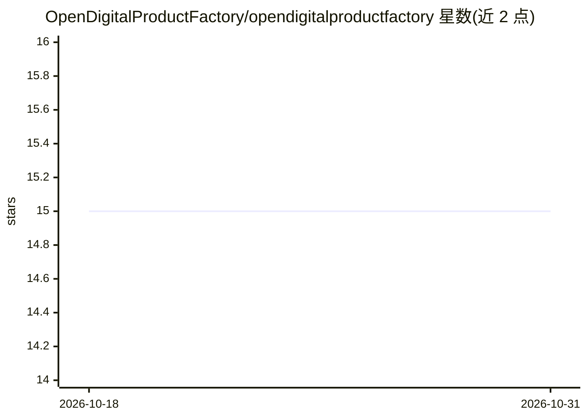

# OpenDigitalProductFactory/opendigitalproductfactory

⭐ 15 · TypeScript · Apache-2.0 · 推送 2026-10-30 · [GitHub](https://github.com/OpenDigitalProductFactory/opendigitalproductfactory) · 组织维护

**本地优先的企业运营平台：受人类授权约束的 AI 同事参与运行业务**

面向单一组织的本地优先数字产品工厂平台：从 100 余种打包业务类型出发，塑造客户体验、工作空间与 AI 同事上下文；AI 同事的工具调用需通过权限、风险策略与审批（HITL），并留有证据链。附带一套 AI agent 可信运行与身份标准草案（TAK/GAID/TAK-JSI），并对齐 NIST、ISO/IEC 等外部标准。仓库托管草案标准文档、安装脚本（Windows/macOS/Linux/云单 VM）与 Next.js 门户、React Native 伴侣应用等源码。限制：Linux 原生与云路径标注为早期访问，部分能力仍需试点证据。

## 筛选速览

| 维度 | 判定 | 备注 |
|---|---|---|
| AI 角色 | `ai-enhanced` | 去掉 AI 部分产品仍成立 |
| 许可风险 | `permissive` | Apache-2.0 |
| 部署形态 | `desktop` | 安装包/桌面程序 |
| 模型依赖 | — | README 未给出锁定关系 |
| 硬件要求 | — | 无带数字的原话,不猜 |
| 安装摩擦 | `low` | 无编译、无系统依赖或容器化 |
| 成熟度 | `idea` | |

## 能力要点

- 100 余种打包业务类型塑造词汇与默认配置，单组织单安装
- AI 工具调用需用户能力+同事授权+风险策略审批，留有证据链
- TAK/GAID/TAK-JSI 等 AI agent 治理标准草案仓库
- Windows/macOS 通用可用安装脚本，Linux/云路径为早期访问试点

## 适用场景

- 以本地部署方式让 AI 同事在授权与审计下参与企业运营
- 按打包业务类型快速建立面向本组织的运营门户
- 查阅并复用 AI agent 可信运行与身份治理标准草案
- 在自有基础设施上试点云端单 VM 部署

## 场景标签

`工作流自动化` · 领域:效率与自动化

## 证据(README 行号)

> L5:  A local-first operating platform where purposed AI coworkers help one organization run and improve its business und
> L24: DPF starts from the business you run rather than an empty software canvas. A packaged business type shapes the cust
> L53: - **AI does not create authority.** A tool call requires both user capability and coworker grant, plus approval or 

## 星数曲线

2026-10-18 15 → 2026-10-31 15（+0）

---
*卡片 v1 · prompt 1.4 · 生成 2026-10-30 · 置信度 low · 依据 README sha `ea577187abbc` · [字段定义](../../DATASET.md)*
