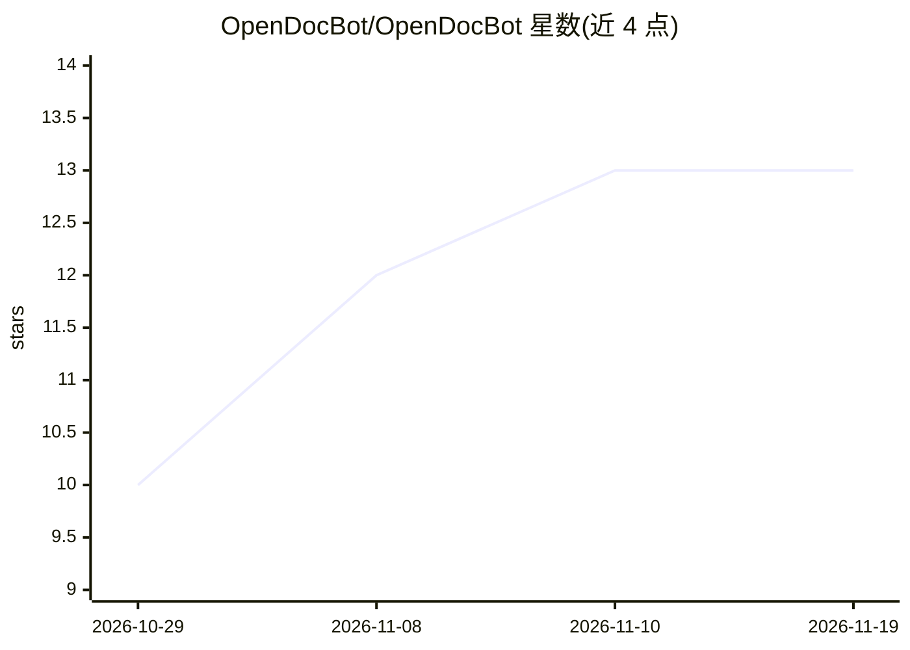

# OpenDocBot/OpenDocBot

⭐ 13 · TypeScript · NOASSERTION · 推送 2026-11-11 · [GitHub](https://github.com/OpenDocBot/OpenDocBot) · [官网](https://opendocbot.com/) · 组织维护 · 中文 README

**面向 M365 用户的客户端 AI Office 加载项，BYOK 可自托管**

一个运行在 Word/Excel/PowerPoint 中的 Microsoft 365 加载项，通过自带 API key 连接多种 AI 提供商，在文档内读写内容、生成公式、自动排版表格与制作幻灯片。任务面板首次从 opendocbot.com 加载后完全在本地运行，文档数据不经服务器。提供人工审批环节与只读的 Suggestion Mode；个人及 30 人以下团队免费，更大规模需商业授权；可自托管并配置 OIDC SSO。

## 筛选速览

| 维度 | 判定 | 备注 |
|---|---|---|
| AI 角色 | `ai-native` | 本体是模型或模型工具 |
| 许可风险 | `none` | NOASSERTION |
| 部署形态 | `self-host` | docker 或自建部署 |
| 模型依赖 | local-ok | 支持本地模型 |
| 硬件要求 | — | 无带数字的原话,不猜 |
| 安装摩擦 | `low` | 无编译、无系统依赖或容器化 |
| 成熟度 | — | 结构信号不足 |

## 能力要点

- 一个加载项覆盖 Word、Excel、PowerPoint 的读写与排版操作
- 接入 OpenAI/Anthropic/Gemini/DeepSeek/Ollama 等多种提供商，可完全离线搭配 Ollama
- 沙箱内执行 Office.js 代码片段，操作前需人工审批
- 支持自托管，含 SSO 与统一 provider 配置

## 适用场景

- 在 Office 文档内用自选模型生成与修改内容
- 通过 Ollama 离线处理敏感文档
- 企业自托管并向全员统一配置 AI 提供商

## 场景标签

`AI 写作` `AI 助手` · 领域:对话与助手

## 证据(README 行号)

> L17: - **Universal Office Suite Integration**: One add-in for Word, Excel, and PowerPoint. Read, write, analyze content,
> L18: - **Provider Freedom & Zero Lock-In**: Connect to OpenAI, Anthropic, Gemini, DeepSeek, Ollama, OpenRouter, OpenCode
> L19: - **100% Client-Side & Local-First**: Zero telemetry. Your document data goes straight from your browser to your pr

## 星数曲线

2026-10-29 10 → 2026-11-19 13（+3）

---
*卡片 v1 · prompt 1.4 · 生成 2026-11-18 · 置信度 mid · 依据 README sha `9f1aa81fddcf` · [字段定义](../../DATASET.md)*
