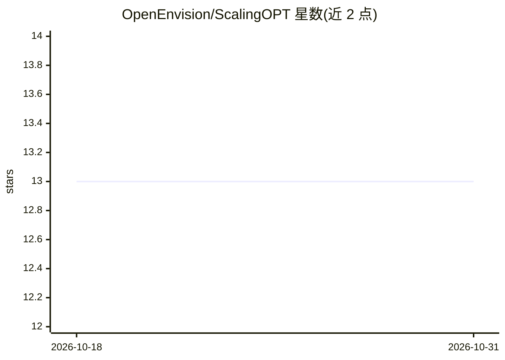

# OpenEnvision/ScalingOPT

⭐ 13 · Python · NOASSERTION · 推送 2026-02-21 · [GitHub](https://github.com/OpenEnvision/ScalingOPT) · [官网](https://tianshijing.github.io/ScalingOpt/) · 组织维护

**面向 LLM 训练的优化器横向对比研究代码库**

基于 PyTorch 的研究型训练代码库，聚焦优化器中心的 scaling 研究：单一入口 main_pretrain.py 通过 --optimizer 参数切换 30 余种优化器（GaLore、APOLLO、Muon、SOAP、Schedule-Free 等），配套 17 个模型配置（LLaMA 9M–13B、GPT-2、Qwen3）、3 套数据管线（C4 流式、Pile 本地 JSONL、OpenWebText 二进制），支持 torchrun 多卡 DDP 与 ≤12GB 显存的量化/逐层低内存模式。后训练覆盖 SFT/DPO/GRPO（TRL）与 PPO（OpenRLHF），可经 lm-evaluation-harness 在 14+ 基准上一键评测。所有模型从零训练，不下载预训练权重。安装需 clone 仓库、装 PyTorch 后 pip install -e .。

## 筛选速览

| 维度 | 判定 | 备注 |
|---|---|---|
| AI 角色 | `ai-ecosystem` | LLM/agent 周边工具 |
| 许可风险 | `none` | NOASSERTION |
| 部署形态 | `library` | 以包/库形式分发 |
| 模型依赖 | — | README 未给出锁定关系 |
| 硬件要求 | `gpu-8g` | |
| 安装摩擦 | `medium` | 含编译或系统依赖之一 |
| 成熟度 | — | 结构信号不足 |

## 能力要点

- 单一入口通过 --optimizer 切换 30 余种优化器，无需改训练循环
- 17 个模型配置（LLaMA 9M–13B / GPT-2 / Qwen3）与 3 套数据管线
- 多卡 DDP（torchrun）与量化/逐层低内存训练（≤12GB VRAM）
- SFT/DPO/GRPO/PPO 后训练与 lm-evaluation-harness 14+ 基准评测

## 适用场景

- 在同一代码库内公平复现多种优化器的 LLM 训练对比实验
- 在单卡低显存环境跑量化训练或逐层优化器变体
- 做从零开始的预训练 + SFT/DPO/GRPO 后训练 + 基准评测的完整流程

## 场景标签

`模型训练` `强化学习` · 领域:训练与推理

## 证据(README 行号)

> L9: ScalingOPT is a research-oriented PyTorch codebase for **optimizer-centric scaling studies** in large language model
> L13: - **Single entrypoint, 30+ optimizers** — switch optimizers with `--optimizer <name>`, no loop rewriting needed.
> L19: - **Evaluation** — one-command eval on 14+ benchmarks via lm-evaluation-harness.

## 星数曲线

2026-10-18 13 → 2026-10-31 13（+0）

---
*卡片 v1 · prompt 1.4 · 生成 2026-10-31 · 置信度 high · 依据 README sha `1fbc946c2c99` · [字段定义](../../DATASET.md)*
