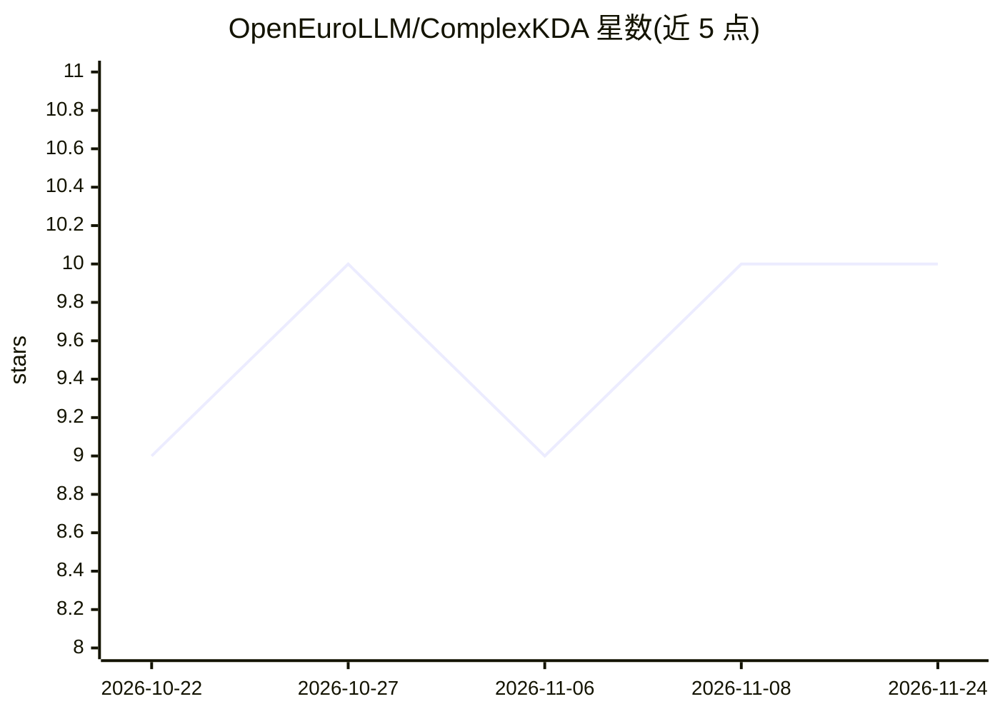

# OpenEuroLLM/ComplexKDA

⭐ 10 · Python · MIT · 推送 2026-11-09 · [GitHub](https://github.com/OpenEuroLLM/ComplexKDA) · [官网](https://arxiv.org/abs/2609.24797) · 组织维护

**Complex Kimi Delta Attention 论文的可复现实验工件库**

该仓库是 Complex Kimi Delta Attention（CKDA）论文的复现工件：基于 Flash Linear Attention 实现 CKDA 层，将 KDA 门控参数扩展到带符号区间（α∈[−1,1]、β∈[0,2]），并包含有限群状态跟踪与周期波形外推两类实验的驱动脚本。面向需要复现论文结果的研究者，提供 CPU smoke 配置、pytest 测试、参考指标 JSON，以及经 Megatron-LM 锁定提交构建的语言模型缩放实验栈；FLA 快照随仓库一并分发，代码为 MIT 许可。

## 筛选速览

| 维度 | 判定 | 备注 |
|---|---|---|
| AI 角色 | `ai-knowledge` | 知识聚合/清单类 |
| 许可风险 | `permissive` | MIT |
| 部署形态 | `None` |  |
| 模型依赖 | — | README 未给出锁定关系 |
| 硬件要求 | — | 无带数字的原话,不猜 |
| 安装摩擦 | `medium` | 含编译或系统依赖之一 |
| 成熟度 | — | 结构信号不足 |

## 能力要点

- CKDA 层实现基于 Flash Linear Attention，扩展 KDA 参数至带符号区间
- 提供 CPU smoke 配置与 pytest 测试用于端到端快速验证
- 有限群状态跟踪（S₃/S₄/A₅）与周期波形外推两组论文实验的复现驱动
- 语言模型缩放实验经 commit 锁定的 Megatron-LM 栈构建

## 适用场景

- 复现论文中的状态跟踪与波形外推实验结果
- 在不同硬件后端（ROCm/XPU/Ascend NPU）上验证 FLA 后端矩阵
- 在 CKDA 基础上做序列模型层的改进实验

## 场景标签

`模型训练` `科研工具` · 领域:学习与行业

## 证据(README 行号)

> L14: This repository is the reproducibility artifact for **Complex Kimi Delta Attention (CKDA)**. It contains the CKDA i
> L16: CKDA extends the ranges of the KDA recurrence parameters to permit signed state transitions: the channel-wise gate 

## 星数曲线

2026-10-22 9 → 2026-11-24 10（+1）

---
*卡片 v1 · prompt 1.4 · 生成 2026-11-20 · 置信度 high · 依据 README sha `5f0b1dcdb87f` · [字段定义](../../DATASET.md)*
