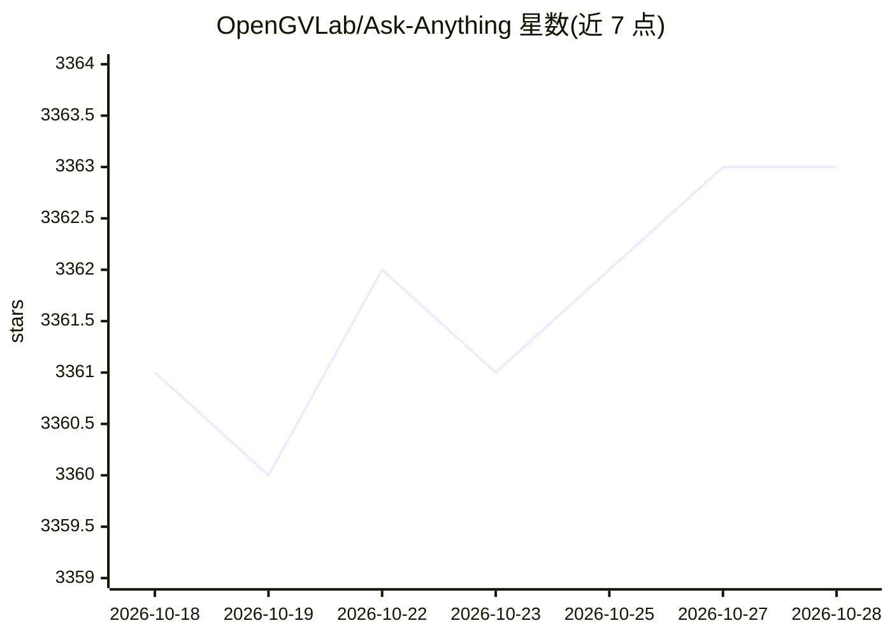

# OpenGVLab/Ask-Anything

⭐ 3,364 · Python · MIT · 推送 2026-07-17 · [GitHub](https://github.com/OpenGVLab/Ask-Anything) · [官网](https://vchat.opengvlab.com/) · 组织维护 · 中文 README

**视频理解对话模型系列 VideoChat：支持多种 LLM 的视频问答**

OpenGVLab/上海AI实验室开源的视频对话模型家族，包含端到端模型 VideoChat/VideoChat2/VideoChat3（发布权重、代码与训练数据），以及通过显式调用 ChatGPT、StableLM、MOSS、MiniGPT-4 构建视频问答的方案；VideoChat2 基于 UMT 与 Vicuna 微调，配套 MVBench 视频理解基准与 2M 指令数据。提供在线 Demo（HuggingFace Spaces、OpenXLab）与 vllm 推理加速分支。多版本论文发表于 arXiv/CVPR2024。

## 筛选速览

| 维度 | 判定 | 备注 |
|---|---|---|
| AI 角色 | `ai-native` | 本体是模型或模型工具 |
| 许可风险 | `permissive` | MIT |
| 部署形态 | `None` |  |
| 模型依赖 | local-ok | 支持本地模型 |
| 硬件要求 | — | 无带数字的原话,不猜 |
| 安装摩擦 | `low` | 无编译、无系统依赖或容器化 |
| 成熟度 | — | 结构信号不足 |

## 能力要点

- 端到端视频/图像对话模型（VideoChat 系列，含 7B/8B 权重）
- 支持 ChatGPT、StableLM、MOSS、MiniGPT-4 等多种 LLM 接入方式
- 发布 MVBench 基准与 2M 指令微调数据
- 提供 vllm 推理加速分支与在线 Demo

## 适用场景

- 对视频进行对话式问答与理解
- 在视频问答方向进行模型微调与基准评测研究
- 复现或对比开源 VideoLLM 的研究工作

## 场景标签

`多模态` `微调` `模型评测` · 领域:评测与运维

## 证据(README 行号)

> L1: # 🦜 VideoChat Family: Ask-Anything
> L21: - **2026/07/17**: 🚀🚀 We release VideoChat3, a fully open, efficient 4B Video MLLM for general, long-form, and strea
> L34:  - VideoChat2 is a robust baseline built on UMT and Vicuna-v0.
> L57: ### Build video chat with:

## 星数曲线

2026-10-18 3,361 → 2026-10-28 3,363（+2）

---
*卡片 v1 · prompt 1.4 · 生成 2026-10-20 · 置信度 high · 依据 README sha `8181888890f3` · [字段定义](../../DATASET.md)*
