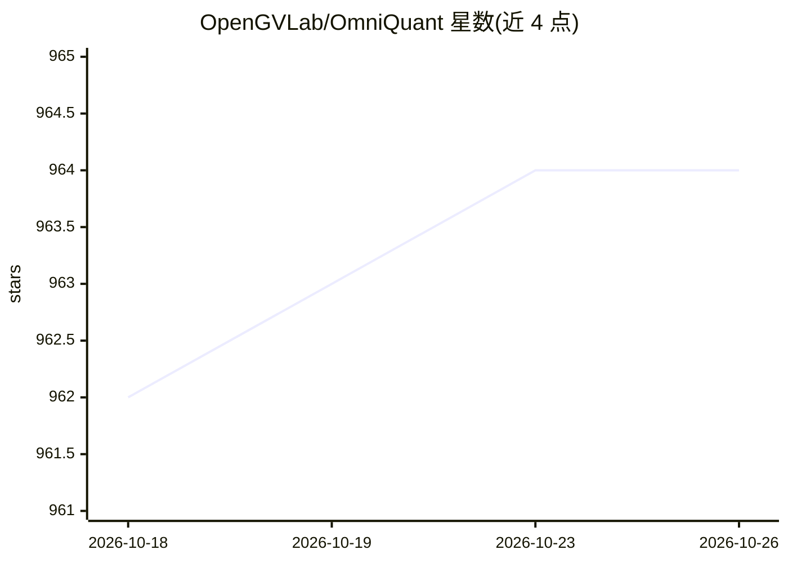

# OpenGVLab/OmniQuant

⭐ 964 · Python · MIT · 推送 2025-11-26 · [GitHub](https://github.com/OpenGVLab/OmniQuant) · 组织维护 · 中文 README

**面向 LLM 的全方向校准量化算法与量化权重生成工具**

ICLR 2024 Spotlight 论文的官方实现：提供 LLM 权重量化（W2/W3/W4A16）与权重-激活量化（W6A6/W4A4）算法，核心机制为可学习权重裁剪（LWC）与可学习等价变换（LET）。面向开发者与科研人员，支持 LLaMA、OPT、Falcon、Mixtral 等模型系列，提供预训练量化参数库可下载后直接生成量化权重，并通过 MLC-LLM 提供 GPU 与手机端部署案例（含 Android/iPhone 上的量化 LLaMA-2-Chat 应用）。安装需配合 bug 修复版 AutoGPTQ 内核，真量化路径下仅权重量化会降低内存但推理变慢。

## 筛选速览

| 维度 | 判定 | 备注 |
|---|---|---|
| AI 角色 | `ai-ecosystem` | LLM/agent 周边工具 |
| 许可风险 | `permissive` | MIT |
| 部署形态 | `library` | 以包/库形式分发 |
| 模型依赖 | — | README 未给出锁定关系 |
| 硬件要求 | — | 无带数字的原话,不猜 |
| 安装摩擦 | `low` | 无编译、无系统依赖或容器化 |
| 成熟度 | — | 结构信号不足 |

## 能力要点

- 支持 W2A16 至 W4A4 多种权重/权重-激活量化配置
- LWC（可学习权重裁剪）与 LET（可学习等价变换）两项核心机制
- 提供 LLaMA/OPT 等系列预训练量化参数库
- 经 MLC-LLM 编译后在 GPU 与手机上运行量化模型，含 Android 演示应用

## 适用场景

- 对 LLaMA、Falcon、Mixtral 等模型做低比特量化以压缩内存占用
- 下载预训练量化参数复现论文评测结果
- 将量化后的 LLaMA-2-Chat 部署到手机端运行

## 场景标签

`模型量化` · 领域:训练与推理

## 证据(README 行号)

> L12: - OmniQuant algorithm for accurate weight-only quantization (`W4A16`/`W3A16`/`W2A16`) and weight-activation quantiz
> L13: - Pre-trained Omniquant model zoo for LLMs (`LLaMA-1&2`, `LLaMA-2-Chat`, `OPT`, `Falcon`, `Mixtral-7Bx8`; load to g
> L127: ## Runing Quantized Models with MLC-LLM

## 星数曲线

2026-10-18 962 → 2026-10-26 964（+2）

---
*卡片 v1 · prompt 1.4 · 生成 2026-10-21 · 置信度 mid · 依据 README sha `b7cef410a07a` · [字段定义](../../DATASET.md)*
