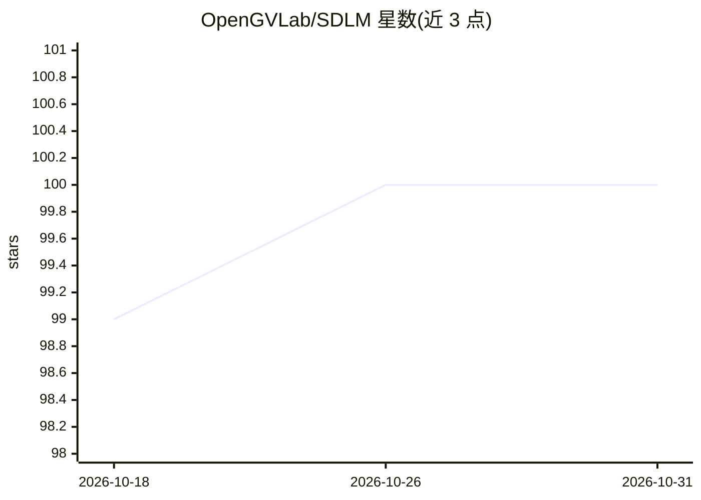

# OpenGVLab/SDLM

⭐ 100 · Python · MIT · 推送 2025-12-27 · [GitHub](https://github.com/OpenGVLab/SDLM) · [官网](https://internvl.github.io/blog/2025-09-29-SDLM/) · 组织维护 · 中文 README

**顺序扩散语言模型：在自回归模型上实现多 token 并行解码加速**

基于预训练自回归语言模型（Qwen2.5 3B/32B）训练的顺序扩散语言模型：每步解码 D 个 token 并保留最长高置信前缀，复用 KV-cache，自适应确定生成长度。提供 Model Zoo、推理（含 HuggingFace transformers 接口与自投机解码）、训练数据与脚本（3.5M 样本）、Opencompass 评测。论文被 EMNLP 2026 主会接收，arXiv:2509.24007。训练依赖 transformers/deepspeed/torch 等指定版本。

## 筛选速览

| 维度 | 判定 | 备注 |
|---|---|---|
| AI 角色 | `ai-native` | 本体是模型或模型工具 |
| 许可风险 | `permissive` | MIT |
| 部署形态 | `None` |  |
| 模型依赖 | — | README 未给出锁定关系 |
| 硬件要求 | — | 无带数字的原话,不猜 |
| 安装摩擦 | `low` | 无编译、无系统依赖或容器化 |
| 成熟度 | — | 结构信号不足 |

## 能力要点

- 每步解码 D 个 token 并保留最长高置信前缀，复用 KV-cache
- 提供 3B/32B 模型权重（HuggingFace）与完整训练、推理、评测代码
- 自投机解码较 vanilla 自回归解码提速近 5×（3B）
- 置信度阈值 τ 可调节速度与性能的权衡

## 适用场景

- 用预训练权重直接推理生成文本并获得加速解码
- 复现或续训扩散语言模型（提供数据与脚本）
- 在 MATH/GSM8K 等基准上评测扩散语言模型

## 场景标签

`模型评测` `模型训练` · 领域:评测与运维

## 证据(README 行号)

> L9: * 🎉 **2025-09-30:** We release the SDLM. Sequential Diffusion Language Model (SDLM) enhances pre-trained autoregress
> L35: We propose a **S**equential **D**iffusion **L**anguage **M**odel (**SDLM**), to cheaply stimulate the parallel pred
> L41: SDLM delivers strong performance with significantly faster decoding speed.

## 星数曲线

2026-10-18 99 → 2026-10-31 100（+1）

---
*卡片 v1 · prompt 1.4 · 生成 2026-10-23 · 置信度 high · 依据 README sha `3e1b4710fd1b` · [字段定义](../../DATASET.md)*
