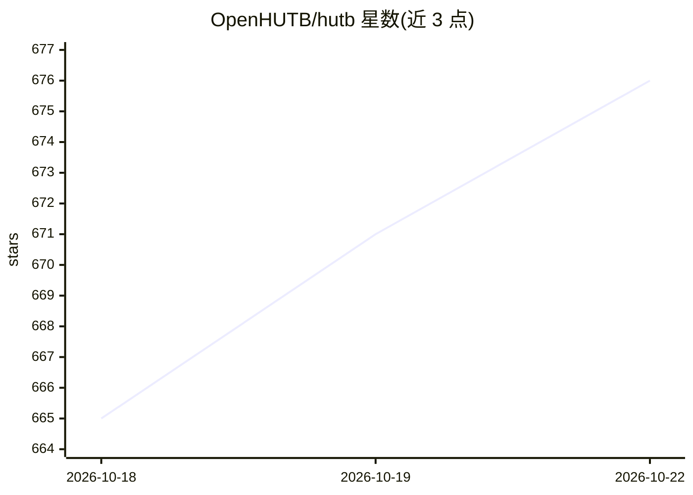

# OpenHUTB/hutb

⭐ 681 · C++ · MIT · 推送 2026-10-19 · [GitHub](https://github.com/OpenHUTB/hutb) · [官网](OpenHUTB.github.io) · 组织维护 · 中文 README

**人车研究用影视级物理模拟器：加速人和机器人算法开发训练验证**

面向具身人、地面/空域/水域载具研究的开源物理模拟平台，用于人和机器人算法的开发、训练与验证，附带可自由使用的开放数字资产（城镇、建筑、载具、行人、道具）。支持 VR 驾驶舱、空地一体、水下机器人、传感器、数据合成、交通管理器、多物理场仿真、行人导航与 Python 接口。基于虚幻引擎构建（运行 CarlaUE4 启动），提供 Windows/Ubuntu 下载脚本与 pip 安装的 Python 工具包（Python 3.7-3.14），也可从源码编译；需较高硬件配置。代码 MIT 开源但整体标注 Non-Commercial，相关资产 CC-BY。

## 筛选速览

| 维度 | 判定 | 备注 |
|---|---|---|
| AI 角色 | `ai-ecosystem` | LLM/agent 周边工具 |
| 许可风险 | `permissive` | MIT |
| 部署形态 | `desktop` | 安装包/桌面程序 |
| 模型依赖 | — | README 未给出锁定关系 |
| 硬件要求 | — | 无带数字的原话,不猜 |
| 安装摩擦 | `low` | 无编译、无系统依赖或容器化 |
| 成熟度 | — | 结构信号不足 |

## 能力要点

- 覆盖具身人、地面/空域/水域载具的物理仿真
- 提供 VR 驾驶舱、传感器、交通管理器、多物理场仿真与 Python 接口
- 附带开放数字资产（城镇布局、建筑、载具、行人、道具）
- 生态含 ScenarioRunner、ROS-bridge、Apollo/AutoWare 桥、强化学习代码等配套仓库

## 适用场景

- 自动驾驶算法的仿真训练与验证
- 行人导航、具身智能与人机交互研究
- 空地一体或水下机器人的传感器与数据合成实验
- 用 VR 驾驶舱采集人类驾驶行为数据

## 场景标签

 · 领域:机器人/自动驾驶仿真

## 证据(README 行号)

> L7: 该项目是一个用于研究 **人** 和 **载具**（具身人、地面载具、空域载具、水域载具）的 **影视级物理模拟器**，旨在加速人和机器人的算法开发、训练和验证。
> L77: * **相关应用**: 包括 感知 、规划 、控制 、端到端 、大模型 、行人 、智能体 、可解释 等

## 星数曲线

2026-10-18 665 → 2026-10-22 676（+11）

---
*卡片 v1 · prompt 1.4 · 生成 2026-10-21 · 置信度 high · 依据 README sha `7b01985de338` · [字段定义](../../DATASET.md)*
