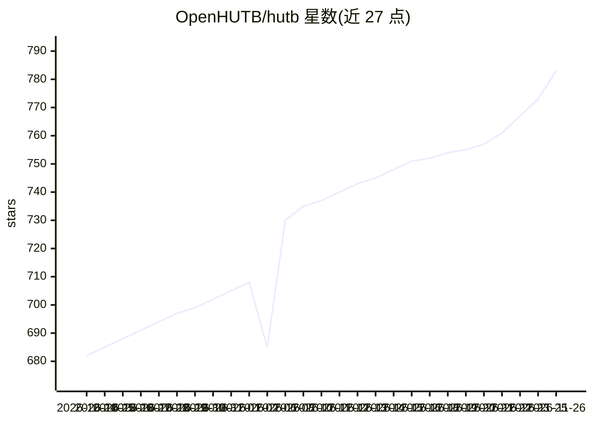

# OpenHUTB/hutb

⭐ 783 · C++ · MIT · 推送 2026-11-24 · [GitHub](https://github.com/OpenHUTB/hutb) · [官网](https://OpenHUTB.github.io) · 组织维护 · 中文 README

**研究人和载具算法的物理模拟器平台**

继承 Carla 模拟器不再维护的分支，面向人和机器人算法的开发、训练与验证，提供影视级物理仿真。覆盖具身人、地面/空域/水域载具，提供开放数字资产（城镇布局、建筑、载具、行人）。增强功能包括 VR 驾驶舱、无人机与水下机器人模式、Mujoco 协同仿真插件、中国城市地图与国产载具资产、Cesium 倾斜摄影插件、一键启动编辑器与全站中文文档。Windows/Ubuntu 提供下载脚本，也可源码编译。

## 筛选速览

| 维度 | 判定 | 备注 |
|---|---|---|
| AI 角色 | `ai-ecosystem` | LLM/agent 周边工具 |
| 许可风险 | `permissive` | MIT |
| 部署形态 | `desktop` | 安装包/桌面程序 |
| 模型依赖 | — | README 未给出锁定关系 |
| 硬件要求 | — | 无带数字的原话,不猜 |
| 安装摩擦 | `low` | 无编译、无系统依赖或容器化 |
| 成熟度 | — | 结构信号不足 |

## 能力要点

- 继承 Carla 并针对国产化场景与通用机器人增强
- VR 驾驶舱模式与罗技方向盘控制
- 提供与 AirSim、HoloOcean、Mujoco 兼容或协同的仿真功能
- 开源代码与可自由使用的开放数字资产（CC-BY/MIT）

## 适用场景

- 开发和验证自动驾驶感知、规划、控制算法
- 在仿真环境中训练机器人与强化学习模型
- 生成中国城市地图场景的仿真数据
- 通过 ROS-bridge 连接机器人软件栈

## 场景标签

`强化学习` `科研工具` · 领域:学习与行业

## 证据(README 行号)

> L7: 该项目是一个用于研究 **人** 和 **载具**（具身人、地面载具、空域载具、水域载具）的 **影视级物理模拟器**，旨在加速人和机器人的算法开发、训练和验证。
> L95: * **相关应用**: 包括 感知 、规划 、控制 、端到端 、大模型 、行人 、智能体 、可解释 等

## 星数曲线

2026-10-24 682 → 2026-11-26 783（+101）

---
*卡片 v1 · prompt 1.4 · 生成 2026-11-25 · 置信度 mid · 依据 README sha `a9618bfff6ba` · [字段定义](../../DATASET.md)*
