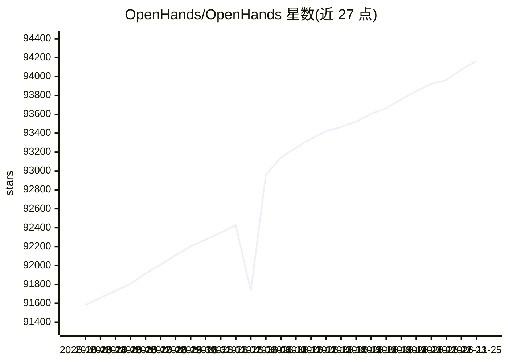

# OpenHands/OpenHands

⭐ 94,165 · TypeScript · MIT · 推送 2026-11-24 · [GitHub](https://github.com/OpenHands/OpenHands) · [官网](https://openhands.dev) · 组织维护

**自托管的编码 Agent 控制中心：统一运行与管理多个 agent**

Agent Canvas 将编码 agent 变成自托管、持续在线的工程团队入口：可运行 OpenHands、Claude Code、Codex、Gemini、Pi、OpenCode 及任何 ACP 兼容 agent，后端可切换本地、Docker、VM、云等多种环境而不丢失会话；支持与 Slack、GitHub、Linear、Notion 等集成的定时/webhook 自动化；默认本地运行，前端与 OpenHands Agent Server（REST API）分离，仓库边界划为 frontend/SDK/typescript-client/automation 四个库。

## 筛选速览

| 维度 | 判定 | 备注 |
|---|---|---|
| AI 角色 | `ai-ecosystem` | LLM/agent 周边工具 |
| 许可风险 | `permissive` | MIT |
| 部署形态 | `self-host` | docker 或自建部署 |
| 模型依赖 | — | README 未给出锁定关系 |
| 硬件要求 | — | 无带数字的原话,不猜 |
| 安装摩擦 | `low` | 无编译、无系统依赖或容器化 |
| 成熟度 | — | 结构信号不足 |

## 动量与使用信号

- 维护:`active` — 距上次 push 0.6 天,年发版 63,461 位贡献者
- 涨星:近 1 天 **+101**(自 20261016 起算)
- 安装:npm 包 `@openhands/agent-canvas` 月下载 17,530

## 能力要点

- 支持 OpenHands、Claude Code、Codex、Gemini CLI、Pi、OpenCode 及任意 ACP 兼容 agent
- 后端可在本地、Docker、VM、云间切换，同一前端管理多个 Agent Server
- 定时/webhook 自动化，集成 Slack、GitHub、Linear 等第三方服务
- 支持无沙盒、单 Docker 沙盒、多 Docker 沙盒、源码四种启动方式

## 适用场景

- 在自托管环境中统一管理多个编码 agent
- 把 GitHub issue 自动分解为任务、生成报告发布到 Slack
- 团队共享 Agent Server 做代码审查与依赖更新
- 让 agent 在服务器上持续运行，笔记本合盖后不中断

## 场景标签

`编码 Agent` `代码审查` `工作流自动化` · 领域:效率与自动化

## 证据(README 行号)

> L4:  The self-hosted developer control center for coding agents and automations.
> L6:  Run OpenHands, Claude Code, Codex, Gemini, Pi, OpenCode, or any ACP-compatible agent across local, remote, and clou
> L186: Agent Canvas is powered by the OpenHands Agent Server, a REST API for running multiple agents on a single machine.

## 星数曲线

2026-10-23 91,581 → 2026-11-25 94,165（+2,584）

---
*卡片 v1 · prompt 1.4 · 生成 2026-11-24 · 置信度 high · 依据 README sha `abbcabeff23c` · [字段定义](../../DATASET.md)*
