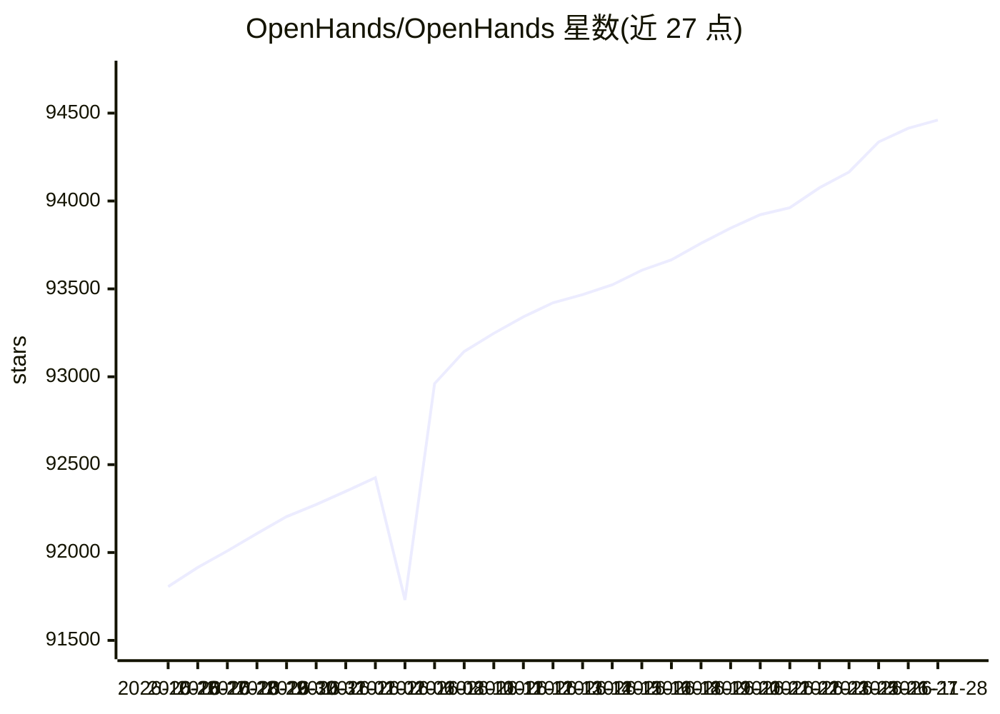

# OpenHands/OpenHands

⭐ 94,461 · TypeScript · MIT · 推送 2026-11-27 · [GitHub](https://github.com/OpenHands/OpenHands) · [官网](https://openhands.dev) · 组织维护

**给开发者的编码 agent 自托管控制中心，统一运行多种 agent**

OpenHands Agent Canvas 是自托管的开发者控制中心，用于启动对话与自动化日常工程任务（如向 Slack 发布报告、将 GitHub issue 分解为任务）。默认本地运行，支持将 agent 后端部署在 Docker 容器、虚拟机或公司基础设施中，并可切换本地/远程/云端后端。内置开源 OpenHands agent，也可接入 Claude Code、Codex、Gemini CLI 等 ACP 兼容第三方 agent。通过 npm 安装或 Docker 镜像运行，提供无沙箱、单沙箱、多沙箱、源码四种启动方式，支持定时与 webhook 触发的自动化。

## 筛选速览

| 维度 | 判定 | 备注 |
|---|---|---|
| AI 角色 | `ai-ecosystem` | LLM/agent 周边工具 |
| 许可风险 | `permissive` | MIT |
| 部署形态 | `self-host` | docker 或自建部署 |
| 模型依赖 | — | README 未给出锁定关系 |
| 硬件要求 | — | 无带数字的原话,不猜 |
| 安装摩擦 | `low` | 无编译、无系统依赖或容器化 |
| 成熟度 | — | 结构信号不足 |

## 动量与使用信号

- 维护:`active` — 距上次 push 0.6 天,年发版 63,461 位贡献者
- 涨星:近 1 天 **+101**(自 20261016 起算)
- 安装:npm 包 `@openhands/agent-canvas` 月下载 17,530

## 能力要点

- 支持本地、Docker、VM、云等多种 agent 后端并可在前端切换
- 兼容 ACP 协议的第三方 agent（Claude Code、Codex、Gemini CLI、Pi、OpenCode）
- 自动化工作流集成 Slack、GitHub、Linear、Notion，支持定时与 webhook 触发
- 多 Docker 沙箱模式支持并发运行多个隔离的 agent 会话

## 适用场景

- 在一台服务器上托管团队的代码审查与依赖更新 agent
- 把 GitHub issue 自动分解为任务并推送到 Slack
- 在本地与云端后端之间切换而不丢失会话焦点

## 场景标签

`编码 Agent` `代码审查` · 领域:编码与开发

## 证据(README 行号)

> L4:  The self-hosted developer control center for coding agents and automations.
> L6:  Run OpenHands, Claude Code, Codex, Gemini, Pi, OpenCode, or any ACP-compatible agent across local, remote, and clou
> L24: OpenHands Agent Canvas turns your coding agents into a self-hosted, always-on engineering team. It's a developer co

## 星数曲线

2026-10-26 91,806 → 2026-11-28 94,461（+2,655）

---
*卡片 v1 · prompt 1.4 · 生成 2026-11-27 · 置信度 high · 依据 README sha `50b59b2644f1` · [字段定义](../../DATASET.md)*
