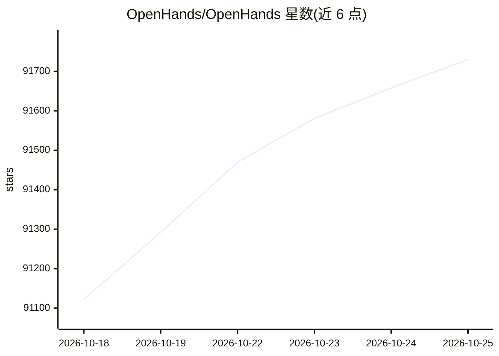

# OpenHands/OpenHands

⭐ 91,806 · TypeScript · MIT · 推送 2026-10-25 · [GitHub](https://github.com/OpenHands/OpenHands) · [官网](https://openhands.dev) · 组织维护

**自托管的编码 agent 控制中心：统一运行与管理多种 coding agent**

OpenHands Agent Canvas 是一个自托管的开发者控制中心，用于启动对话与自动化日常任务（如发布到 Slack 的报告、自动拆解 GitHub issue 为任务）。默认本地运行，可连接多种 agent 后端：本地、Docker 容器、VM 或云端（OpenHands Cloud/Enterprise）。开箱运行开源 OpenHands agent，也可接入 Claude Code、Codex、Gemini、Pi、OpenCode 等 ACP 兼容第三方 agent。提供 npm 全局安装、Docker 沙箱（含多容器隔离）与源码运行三种方式，并支持定时/webhook 触发的自动化与 Slack、GitHub、Linear 等集成。项目标注为 beta。

## 筛选速览

| 维度 | 判定 | 备注 |
|---|---|---|
| AI 角色 | `ai-ecosystem` | LLM/agent 周边工具 |
| 许可风险 | `permissive` | MIT |
| 部署形态 | `library` | 以包/库形式分发 |
| 模型依赖 | — | README 未给出锁定关系 |
| 硬件要求 | — | 无带数字的原话,不猜 |
| 安装摩擦 | `low` | 无编译、无系统依赖或容器化 |
| 成熟度 | `idea` | |

## 动量与使用信号

- 维护:`active` — 距上次 push 0.6 天,年发版 63,461 位贡献者
- 涨星:近 1 天 **+101**(自 20261016 起算)
- 安装:npm 包 `@openhands/agent-canvas` 月下载 17,530

## 能力要点

- 本地/Docker/VM/云端多后端切换运行 agent
- 支持 OpenHands、Claude Code、Codex、Gemini、Pi、OpenCode 及任意 ACP 兼容 agent
- Automations：按计划或 webhook 事件触发，集成 Slack/GitHub/Linear/Notion
- Docker 沙箱与多容器隔离（每个会话独立容器）

## 适用场景

- 在自己机器或服务器上集中运行多个编码 agent
- 把 GitHub issue 自动拆解为任务并生成发布到 Slack 的报告
- 团队共享 Agent Server 做代码审查与依赖更新

## 场景标签

`编码 Agent` · 领域:编码与开发

## 证据(README 行号)

> L25: OpenHands Agent Canvas turns your coding agents into a self-hosted, always-on engineering team. It's a developer co
> L29: Agent Canvas runs the open source OpenHands agent out-of-the-box, but can use third-party agents such as Claude Cod
> L133: Agent Canvas is powered by the OpenHands Agent Server, a REST API for running multiple agents on a single machine.

## 星数曲线

2026-10-18 91,122 → 2026-10-25 91,730（+608）

---
*卡片 v1 · prompt 1.4 · 生成 2026-10-20 · 置信度 high · 依据 README sha `c23ab7c385e3` · [字段定义](../../DATASET.md)*
