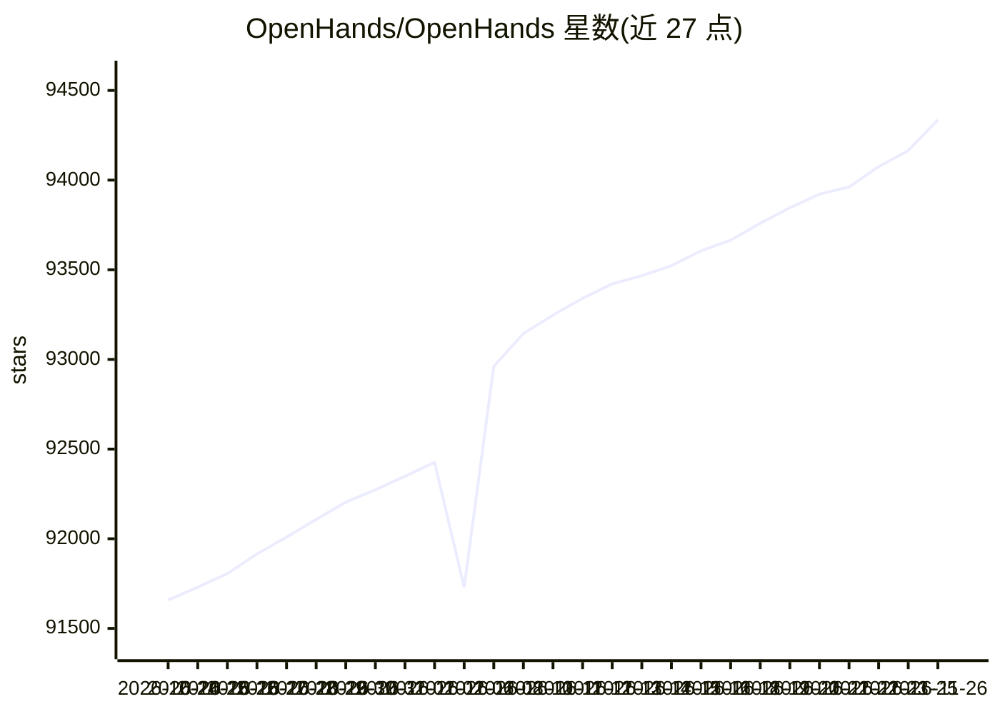

# OpenHands/OpenHands

⭐ 94,336 · TypeScript · MIT · 推送 2026-11-25 · [GitHub](https://github.com/OpenHands/OpenHands) · [官网](https://openhands.dev) · 组织维护

**自托管的编码 agent 控制中心：本地/云端运行与自动化**

Agent Canvas 是一个自托管开发者控制中心，用于启动和编排 coding agent 对话与自动化任务。默认运行开源 OpenHands agent，也可接入 Claude Code、Codex、Gemini CLI、Pi、OpenCode 等支持 ACP 协议的第三方 agent。后端可运行在本地、Docker、VM 或云上，支持多后端切换；配套 Automation Server 支持按计划或 webhook 触发任务，并可集成 Slack、GitHub、Notion 等服务。提供 npm 全局安装、Docker 镜像、多沙箱与源码四种运行方式。

## 筛选速览

| 维度 | 判定 | 备注 |
|---|---|---|
| AI 角色 | `ai-ecosystem` | LLM/agent 周边工具 |
| 许可风险 | `permissive` | MIT |
| 部署形态 | `self-host` | docker 或自建部署 |
| 模型依赖 | — | README 未给出锁定关系 |
| 硬件要求 | — | 无带数字的原话,不猜 |
| 安装摩擦 | `low` | 无编译、无系统依赖或容器化 |
| 成熟度 | — | 结构信号不足 |

## 动量与使用信号

- 维护:`active` — 距上次 push 0.6 天,年发版 63,461 位贡献者
- 涨星:近 1 天 **+101**(自 20261016 起算)
- 安装:npm 包 `@openhands/agent-canvas` 月下载 17,530

## 能力要点

- 支持 OpenHands、Claude Code、Codex、Gemini CLI 等任何 ACP 兼容 agent
- 后端可在本地、Docker、VM、云之间切换且不丢失上下文
- 自动化工作流可按计划或 webhook 触发并集成 Slack/GitHub/Linear
- 架构拆分为 Canvas 前端、Agent Server、SDK 与 automation 多仓库

## 适用场景

- 把 GitHub issue 自动分解为任务并跟进
- 生成报告并定时发布到 Slack
- 团队共享一台 Agent Server 做代码审查与依赖更新
- 在笔记本关闭后让 agent 继续在服务器运行

## 场景标签

`编码 Agent` `工作流自动化` `代码审查` · 领域:效率与自动化

## 证据(README 行号)

> L4:  The self-hosted developer control center for coding agents and automations.
> L6:  Run OpenHands, Claude Code, Codex, Gemini, Pi, OpenCode, or any ACP-compatible agent across local, remote, and clou
> L24: OpenHands Agent Canvas turns your coding agents into a self-hosted, always-on engineering team. It's a developer co

## 星数曲线

2026-10-24 91,658 → 2026-11-26 94,336（+2,678）

---
*卡片 v1 · prompt 1.4 · 生成 2026-11-26 · 置信度 high · 依据 README sha `f66670885a5e` · [字段定义](../../DATASET.md)*
