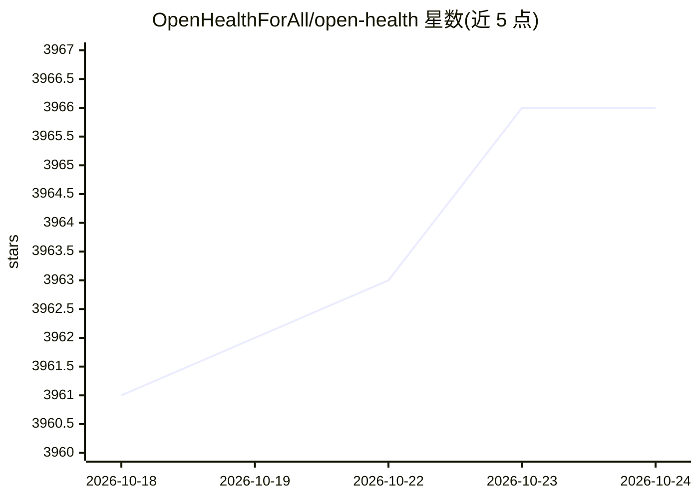

# OpenHealthForAll/open-health

⭐ 3,966 · TypeScript · AGPL-3.0 · 推送 2026-01-06 · [GitHub](https://github.com/OpenHealthForAll/open-health) · [官网](https://www.open-health.me) · 组织维护 · 中文 README

**本地运行的 AI 个人健康助手：解析你的健康数据并提供对话**

面向个人用户的健康助手应用：集中录入血液检查、体检数据、个人体征、家族病史与症状等健康数据，自动解析生成结构化数据文件，再以此作为上下文与 GPT 驱动的 AI 进行个性化对话。支持 LLaMA、DeepSeek-V3、GPT、Claude、Gemini 等模型，解析环节可用 docling、LLM 环节可用 Ollama 实现完全本地运行以保护隐私。安装方式为 git clone 源码后以 Docker/Podman Compose 启动，浏览器访问 localhost:3000 使用；数据解析目前由独立 Python 服务实现，计划迁移至 TypeScript。另提供 Clinic 与 Full Platform 两种 Web 选项。

## 筛选速览

| 维度 | 判定 | 备注 |
|---|---|---|
| AI 角色 | `ai-native` | 本体是模型或模型工具 |
| 许可风险 | `viral` | AGPL-3.0 |
| 部署形态 | `None` |  |
| 模型依赖 | local-ok | 支持本地模型 |
| 硬件要求 | — | 无带数字的原话,不猜 |
| 安装摩擦 | `low` | 无编译、无系统依赖或容器化 |
| 成熟度 | — | 结构信号不足 |

## 能力要点

- 集中录入血液检查、体检、家族病史等多类健康数据
- 自动解析健康数据并生成结构化文件
- 结构化数据作为上下文支撑个性化 AI 对话
- 支持 docling 解析与 Ollama 实现完全本地运行

## 适用场景

- 集中管理我的各项健康数据并咨询 AI 获取解释
- 用本地模型处理敏感健康数据以保护隐私
- 把血液检查和体检报告整理成结构化记录

## 场景标签

`AI 助手` `文档问答` · 领域:对话与助手

## 证据(README 行号)

> L21: > OpenHealth helps you **take charge of your health data**. By leveraging AI and your personal health information,
> L29: - 🛠️ **Smart Parsing:** Automatically parses your health data and generates structured data files.

## 星数曲线

2026-10-18 3,961 → 2026-10-24 3,966（+5）

---
*卡片 v1 · prompt 1.4 · 生成 2026-10-20 · 置信度 high · 依据 README sha `0cdaac9abeec` · [字段定义](../../DATASET.md)*
