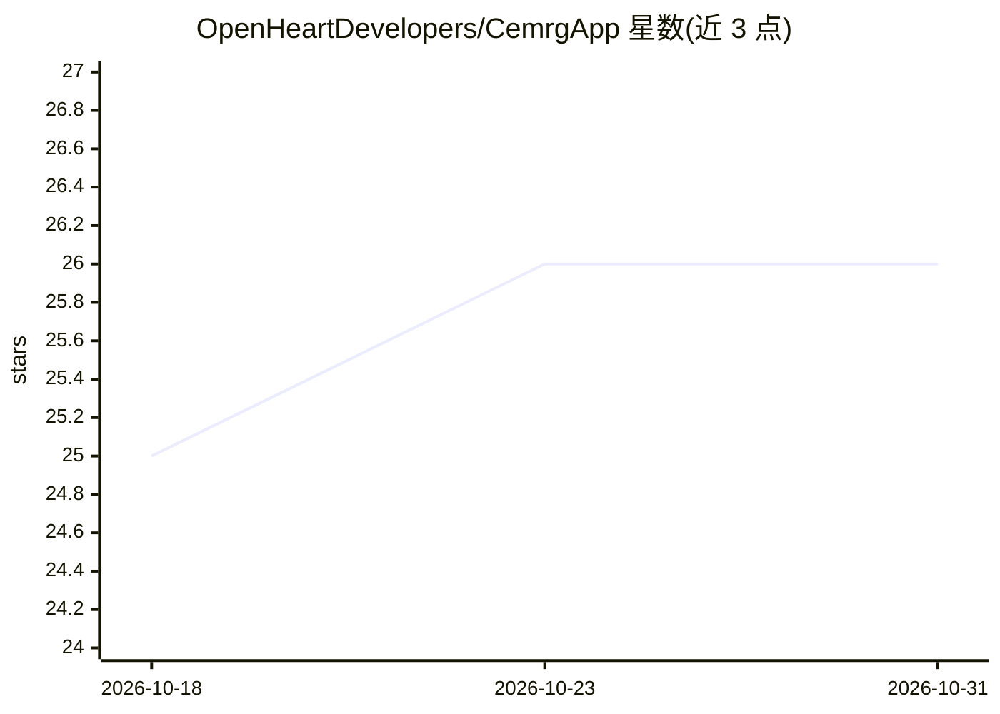

# OpenHeartDevelopers/CemrgApp

⭐ 26 · C++ · BSD-3-Clause · 推送 2026-09-07 · [GitHub](https://github.com/OpenHeartDevelopers/CemrgApp) · [官网](http://www.cemrgapp.com) · 组织维护

**心血管研究用交互式医学影像应用（MITK 基础）**

基于 MITK 的交互式医学影像应用，面向心血管研究，集成图像处理、计算机视觉与机器学习工具包。README 未给出安装命令，指引查阅项目 Wiki；软件以 3-clause BSD 许可发布，声明不含任何保证与支持，且声明不应用于患者诊断或治疗。使用时需引用 2020 年发表于 SoftwareX 的论文。

## 筛选速览

| 维度 | 判定 | 备注 |
|---|---|---|
| AI 角色 | `ai-native` | 本体是模型或模型工具 |
| 许可风险 | `permissive` | BSD-3-Clause |
| 部署形态 | `None` |  |
| 模型依赖 | — | README 未给出锁定关系 |
| 硬件要求 | — | 无带数字的原话,不猜 |
| 安装摩擦 | `low` | 无编译、无系统依赖或容器化 |
| 成熟度 | — | 结构信号不足 |

## 能力要点

- 基于 MITK 的交互式医学影像应用
- 集成图像处理、计算机视觉与机器学习工具包
- 以 3-clause BSD 许可开源，附 SoftwareX 论文引用条目

## 适用场景

- 心血管研究中进行医学影像的交互式处理与分析
- 结合机器学习工具包开展心脏影像研究工作流

## 场景标签

`图像视频处理` · 领域:感知与多模态

## 证据(README 行号)

> L7: CemrgApp is an MITK based interactive medical imaging application with image processing and computer vision toolkits
> L20: Razeghi O, Solís-Lemus J, Lee A et al. CemrgApp: An interactive medical imaging application with image processing, 

## 星数曲线

2026-10-18 25 → 2026-10-31 26（+1）

---
*卡片 v1 · prompt 1.4 · 生成 2026-10-26 · 置信度 mid · 依据 README sha `dbd9d70728f5` · [字段定义](../../DATASET.md)*
