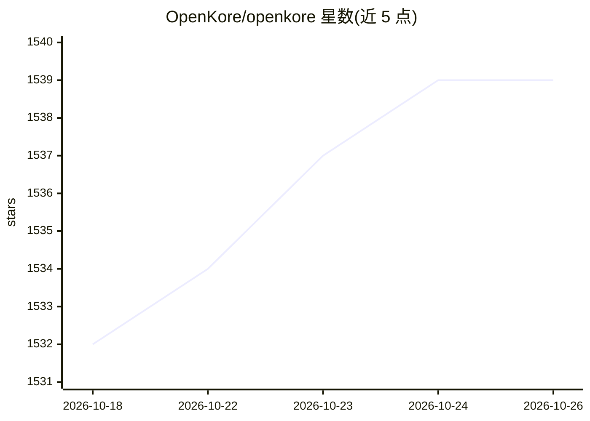

# OpenKore/openkore

⭐ 1,539 · Perl · NOASSERTION · 推送 2026-10-20 · [GitHub](https://github.com/OpenKore/openkore) · [官网](https://openkore.com) · 组织维护

**仙境传说（RO）的免费开源自定义客户端与自动化挂机工具**

用 Perl 编写的跨平台（Linux/Windows/macOS）程序，作为 Ragnarok Online 的自定义客户端运行，并提供自动化操作能力。通过 git clone 获取源码，配置后以 openkore.pl 运行（Windows 可用 start.exe / wxstart.exe），前置需求参见 Wiki 的 Requirements 页面。README 附有官方服务器可用状态表，列出的各官方服均标注 Not working。采用 GPL v2 许可证发布，由社区志愿者在业余时间维护。

## 筛选速览

| 维度 | 判定 | 备注 |
|---|---|---|
| AI 角色 | `ai-enhanced` | 去掉 AI 部分产品仍成立 |
| 许可风险 | `none` | NOASSERTION |
| 部署形态 | `desktop` | 安装包/桌面程序 |
| 模型依赖 | — | README 未给出锁定关系 |
| 硬件要求 | — | 无带数字的原话,不猜 |
| 安装摩擦 | `low` | 无编译、无系统依赖或容器化 |
| 成熟度 | — | 结构信号不足 |

## 能力要点

- Ragnarok Online 的自定义客户端，跨平台支持 Linux/Windows/macOS
- git clone 源码方式获取，运行 openkore.pl 启动
- README 维护官方服务器兼容状态表
- GPL v2 开源许可

## 适用场景

- 在 RO 私服上运行自动化客户端
- 查阅各官方服务器的工具可用状态
- 参与开源社区开发与问题反馈

## 场景标签

 · 领域:游戏/自动化工具

## 证据(README 行号)

> L18: * OpenKore is a custom client and intelligent automated assistant for Ragnarok Online.
> L19: * It is a **free**, open source and cross-platform program _(Linux, Windows and MacOS are supported)_.

## 星数曲线

2026-10-18 1,532 → 2026-10-26 1,539（+7）

---
*卡片 v1 · prompt 1.4 · 生成 2026-10-21 · 置信度 mid · 依据 README sha `ee7aee58c3a8` · [字段定义](../../DATASET.md)*
