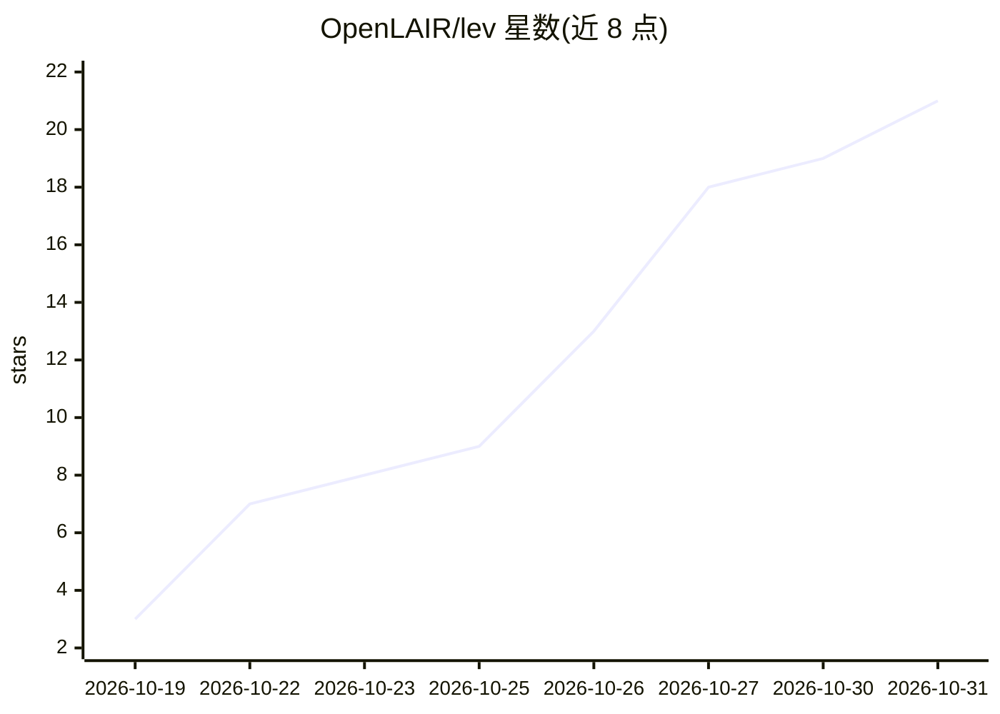

# OpenLAIR/lev

⭐ 21 · Python · Apache-2.0 · 推送 2026-10-19 · [GitHub](https://github.com/OpenLAIR/lev) · [官网](https://openlair.github.io/lev/) · 组织维护

**单检查点多深度的循环决策模型：对给定选项输出概率**

将预训练循环语言模型改造为类型化决策模型的研究项目：共享指针头在每次循环步后对调用方提供的每个选项返回一个概率，同一检查点可选 1–4 档计算深度（Lev-1.4B/2.6B/3B，骨干为 Ouro 系列与 Nanbeige4.2-3B）。发布代码、三个 LoRA 检查点与三个数据集（LevBench 等），提供 CPU 测试安装与 CUDA 推理示例。限制：自适应路由仅为离线分析；Lev-2.6B 在三颗种子下未通过锁定 LevBench G3；全尺寸 GPU 对齐与完整数据重建未重跑。

## 筛选速览

| 维度 | 判定 | 备注 |
|---|---|---|
| AI 角色 | `ai-native` | 本体是模型或模型工具 |
| 许可风险 | `permissive` | Apache-2.0 |
| 部署形态 | `None` |  |
| 模型依赖 | — | README 未给出锁定关系 |
| 硬件要求 | — | 无带数字的原话,不猜 |
| 安装摩擦 | `medium` | 含编译或系统依赖之一 |
| 成熟度 | `idea` | |

## 能力要点

- 同一检查点支持最多 4 档原生深度，按深度调节计算量
- 共享指针头为每个调用方选项输出概率，不生成答案字符串
- 发布三个模型检查点与三个数据集（LevBench/训练混合/结果数据）
- 提供论文复现路径：13 张图中 7 张可从打包聚合结果重绘

## 适用场景

- 在固定输出格式为选项概率的场景下做多深度权衡评测
- 复现论文结果与检查深度-精度关系
- 研究循环模型早退与自适应计算

## 场景标签

`模型评测` · 领域:评测与运维

## 证据(README 行号)

> L31: Lev adapts pretrained recurrent language models into typed decision models. A shared pointer head returns a probabi
> L45: |**Lev-1.4B**|Ouro-1.4B|1–4|58.0% → 68.0%|🤗 Lev-1.4B · Model card|

## 星数曲线

2026-10-19 3 → 2026-10-31 21（+18）

---
*卡片 v1 · prompt 1.4 · 生成 2026-10-29 · 置信度 high · 依据 README sha `5928c884fb8f` · [字段定义](../../DATASET.md)*
