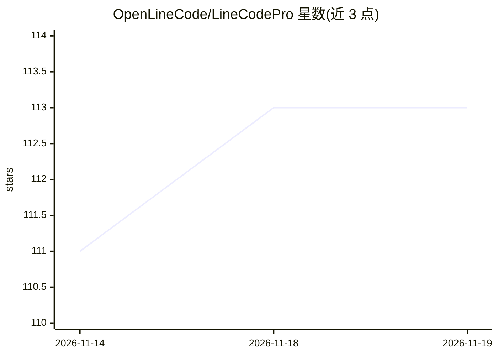

# OpenLineCode/LineCodePro

⭐ 113 · Java · AGPL-3.0 · 推送 2026-11-18 · [GitHub](https://github.com/OpenLineCode/LineCodePro) · 个人维护 · 中文 README

**Android 端的 AI 编程工作台，手机上对话改代码、执行命令**

用 Java 11 手写的 Android AI 编程工作区：模型无关的流式对话（OpenAI 兼容、Anthropic Messages、Codex Responses，及可选本地 GGUF/llama.cpp），模型可通过工具循环读写项目文件、执行审批后的 shell 命令、搜索网页、处理图像、委派给自定义 Agent，并支持 SKILL.md 技能包与 HTTP MCP 服务器。工作区可选应用内项目、SSH 主机、Termux 或 AIDL 终端；文件操作产生可回滚的 diff 记录，完整执行时间线可审阅。默认 slim 构建不含本地模型；GitHub Releases 提供预构建 APK，也可用 Gradle 从源码构建。项目自述处于活跃开发中。

## 筛选速览

| 维度 | 判定 | 备注 |
|---|---|---|
| AI 角色 | `ai-native` | 本体是模型或模型工具 |
| 许可风险 | `dual` | AGPL-3.0 |
| 部署形态 | `desktop` | 安装包/桌面程序 |
| 模型依赖 | local-ok | 支持本地模型 |
| 硬件要求 | — | 无带数字的原话,不猜 |
| 安装摩擦 | `high` | 编译与系统依赖俱全 |
| 成熟度 | `idea` | |

## 能力要点

- 模型无关流式对话：OpenAI 兼容 / Anthropic / Codex / 可选本地 GGUF（llama.cpp JNI）
- 完整工具循环 + 多 Agent 委派 + SKILL.md 技能包 + HTTP MCP 服务器
- 工作区支持 SSH / Termux / AIDL 终端，文件改动带 diff 与回滚
- 数据本地 SQLite 存储，工具执行支持自动/确认/只读策略

## 适用场景

- 在手机上让 AI 模型检视并修改项目文件、执行命令
- 通过 SSH 或 Termux 在远程/本地终端环境上让 agent 工作
- 安装社区技能包并连接 MCP 服务器扩展 agent 能力

## 场景标签

`编码 Agent` · 领域:编码与开发

## 证据(README 行号)

> L12: **LineCode Pro is an Android AI coding workspace built in hand-written Java 11.** It combines streaming conversatio
> L26: - **Model-independent conversations** — OpenAI-compatible Chat Completions, OpenAI/Codex Responses, Anthropic Messa

## 星数曲线

2026-11-14 111 → 2026-11-19 113（+2）

---
*卡片 v1 · prompt 1.4 · 生成 2026-11-17 · 置信度 high · 依据 README sha `3369de0443fe` · [字段定义](../../DATASET.md)*
