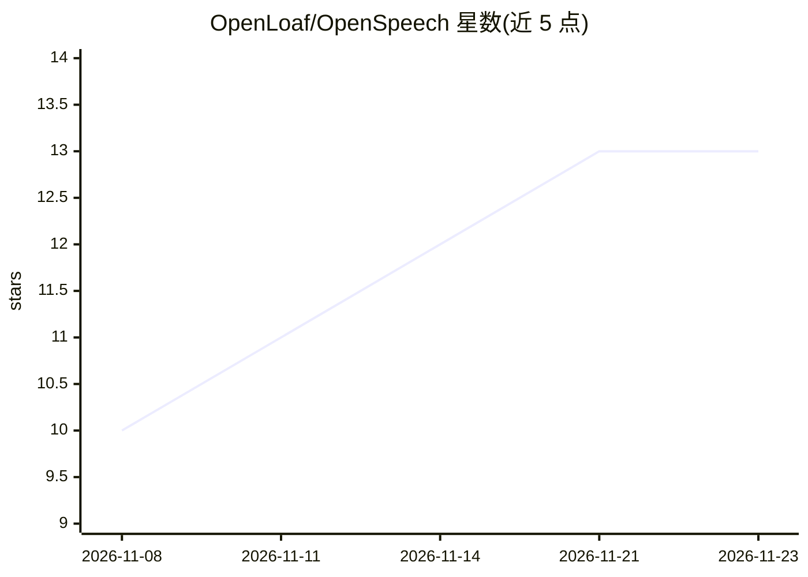

# OpenLoaf/OpenSpeech

⭐ 13 · Rust · NOASSERTION · 推送 2026-11-02 · [GitHub](https://github.com/OpenLoaf/OpenSpeech) · [官网](https://openspeech-website.hexems.com) · 组织维护 · 中文 README

**跨平台 AI 语音输入桌面应用：按键说话即转文字入光标**

OpenSpeech 是一款跨平台桌面端语音输入工具，支持 Windows/macOS/Linux：按快捷键录音，转写经 AI 清洗后写入任意应用的光标位置。功能包括翻译听写（8 种目标语言）、会议转录与 Markdown 纪要、16 个专业领域术语保护、个人字典、本地历史与用量统计。转写与 AI 整理依赖云端服务：ASR 支持腾讯云、阿里百炼，AI 整理走 OpenAI 协议兼容端点，密钥存系统钥匙串。安装包通过 Releases 分发；前端源码在私有仓库以预构建 npm 包分发，仅 Tauri/Rust 部分开源。许可证为 PolyForm Noncommercial 1.0.0，仅限非商业用途。

## 筛选速览

| 维度 | 判定 | 备注 |
|---|---|---|
| AI 角色 | `ai-native` | 本体是模型或模型工具 |
| 许可风险 | `none` | NOASSERTION |
| 部署形态 | `desktop` | 安装包/桌面程序 |
| 模型依赖 | — | README 未给出锁定关系 |
| 硬件要求 | — | 无带数字的原话,不猜 |
| 安装摩擦 | `low` | 无编译、无系统依赖或容器化 |
| 成熟度 | — | 结构信号不足 |

## 能力要点

- 快捷键听写，转写经 AI 清洗后写入光标位置
- 翻译听写（8 种目标语言）与会议转录生成 Markdown 纪要
- 16 个专业领域术语保护与个人字典
- 自定义 ASR/AI 供应商，兼容 OpenAI 协议端点

## 适用场景

- 在 VS Code、聊天框、邮件等任意输入框语音打字
- 说中文让光标处直接输出英文等目标语言
- 会议录音自动按发言人分段并生成纪要
- 医学、法律等领域口述时保留专业术语

## 场景标签

`语音识别` · 领域:感知与多模态

## 证据(README 行号)

> L7:  跨平台 AI 语音输入桌面应用 · Voice typing for every app.
> L19: OpenSpeech 是一款跨平台的桌面端语音输入工具：在任何应用、任何输入框，按一下快捷键开始说话，再按一下就把转写文字写到光标位置。Windows / macOS / Linux 三端同步发布。
> L21: **说一段大白话，落到光标里就是结构化文档。** 录音 → 转写 → AI 清洗，口误、语气词、自我纠错全部抹平，再按你想要的格式重排：

## 星数曲线

2026-11-08 10 → 2026-11-23 13（+3）

---
*卡片 v1 · prompt 1.4 · 生成 2026-11-18 · 置信度 mid · 依据 README sha `2a270176b18c` · [字段定义](../../DATASET.md)*
