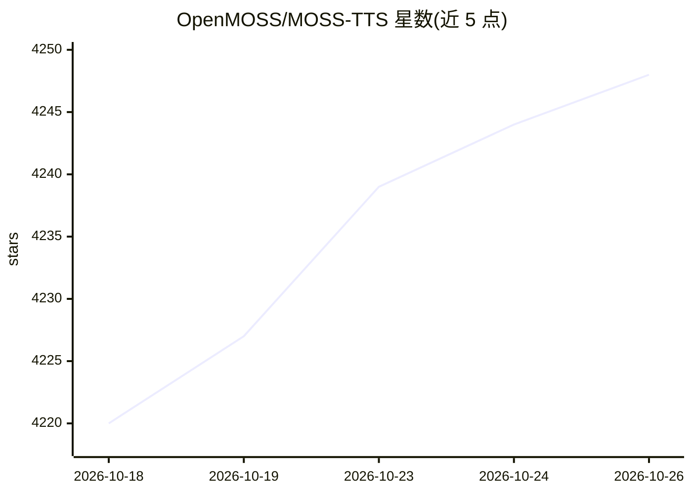

# OpenMOSS/MOSS-TTS

⭐ 4,248 · Python · Apache-2.0 · 推送 2026-09-06 · [GitHub](https://github.com/OpenMOSS/MOSS-TTS) · [官网](https://mosi.cn/models/moss-tts) · 组织维护 · 中文 README

**开源语音/音效生成模型家族：长语音、对话、音色设计与流式 TTS**

由 MOSI.AI 与 OpenMOSS 团队发布的语音与声音生成模型家族，包含五个可独立或组合使用的模型：MOSS-TTS（零样本语音克隆、长语音、拼音/音素/时长控制）、MOSS-TTSD（多说话人超长对话生成）、MOSS-VoiceGenerator（从文本提示直接生成音色）、MOSS-TTS-Realtime（面向语音 Agent 的低延迟流式合成，TTFB 180ms）与 MOSS-SoundEffect（音效生成）。v1.5 支持约 31 种语言。推理后端包括 SGLang-Omni、vLLM-Omni、llama.cpp（GGUF+ONNX 免 PyTorch 路线）及 mlx-audio；提供微调教程与模型权重（Hugging Face/ModelScope）。

## 筛选速览

| 维度 | 判定 | 备注 |
|---|---|---|
| AI 角色 | `ai-native` | 本体是模型或模型工具 |
| 许可风险 | `permissive` | Apache-2.0 |
| 部署形态 | `library` | 以包/库形式分发 |
| 模型依赖 | local-ok | 支持本地模型 |
| 硬件要求 | — | 无带数字的原话,不猜 |
| 安装摩擦 | `medium` | 含编译或系统依赖之一 |
| 成熟度 | — | 结构信号不足 |

## 能力要点

- 五种模型覆盖语音克隆、对话合成、音色设计、音效与实时流式 TTS
- MOSS-TTS-Nano 约 100M 参数，可在 4 个 CPU 核心上运行流式输出
- llama.cpp + ONNX Runtime 免 PyTorch 推理路径，8B 模型量化后适配 8GB GPU
- v1.5 支持 31 种语言与 [pause X.Ys] 显式停顿控制

## 适用场景

- 为有声书、播客等场景生成稳定的长篇多语言语音
- 搭建低延迟语音 Agent 的实时流式 TTS
- 从文本描述设计音色，无需参考音频
- 为影视、游戏生成可控时长的环境音效

## 场景标签

`语音合成` · 领域:内容生成

## 证据(README 行号)

> L18: MOSS‑TTS Family is an open‑source **speech and sound generation model family** from MOSI.AI and the OpenMOSS team. 
> L67: - **MOSS‑TTS**: The flagship production model featuring high fidelity and optimal zero-shot voice cloning. It suppo
> L70: - **MOSS‑TTS‑Realtime**: A multi-turn context-aware model for real-time voice agents. It uses incremental synthesis

## 星数曲线

2026-10-18 4,220 → 2026-10-26 4,248（+28）

---
*卡片 v1 · prompt 1.4 · 生成 2026-10-20 · 置信度 high · 依据 README sha `6ba807357168` · [字段定义](../../DATASET.md)*
