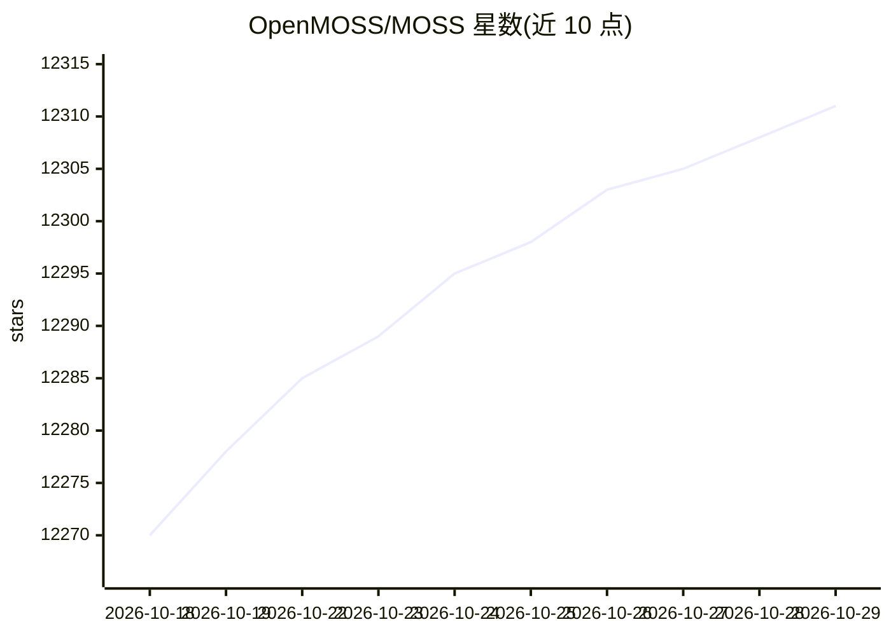

# OpenMOSS/MOSS

⭐ 12,311 · Python · Apache-2.0 · 推送 2026-09-06 · [GitHub](https://github.com/OpenMOSS/MOSS) · [官网](https://txsun1997.github.io/blogs/moss.html) · 组织维护 · 中文 README

**复旦开源的中英双语对话语言模型及部署微调代码**

MOSS-003 系列是 160 亿参数、支持中英双语对话与工具调用的开源语言模型，本仓库提供基座/SFT/插件增强及 INT4/INT8 量化版本，附多轮对话数据与插件增强数据、基于 transformers 的推理代码、SFT 微调代码，以及 Streamlit/Gradio 网页 Demo、命令行 Demo 和 API Demo。插件版支持搜索引擎、文生图、计算器、解方程四类插件，通过特殊 token 格式与两段式调用实现。FP16 需单张 A100/A800 或两张 3090，INT4 可单张 3090 运行；README 声明模型仍可能生成事实性错误或有害内容。

## 筛选速览

| 维度 | 判定 | 备注 |
|---|---|---|
| AI 角色 | `ai-native` | 本体是模型或模型工具 |
| 许可风险 | `permissive` | Apache-2.0 |
| 部署形态 | `self-host` | docker 或自建部署 |
| 模型依赖 | — | README 未给出锁定关系 |
| 硬件要求 | `gpu-8g` | |
| 安装摩擦 | `low` | 无编译、无系统依赖或容器化 |
| 成熟度 | `idea` | |

## 能力要点

- moss-moon-003 系列 160 亿参数模型，含 INT4/INT8 量化版本
- 插件增强版支持搜索引擎、文生图、计算器、解方程四类插件
- 开源约 110 万条多轮对话数据与 30 万条插件增强对话数据
- 提供 SFT 微调代码与网页/命令行/API 多种 Demo

## 适用场景

- 本地部署中英双语对话模型进行多轮对话
- 结合搜索引擎等插件做工具增强问答
- 在自有对话数据上微调 MOSS 基座模型

## 场景标签

`微调` `模型量化` `推理引擎` · 领域:训练与推理

## 证据(README 行号)

> L11: **MOSS 是支持中英双语对话与工具调用的开源语言模型。本仓库提供 MOSS-003 系列模型、对话数据、部署与微调代码。**
> L50: MOSS是一个支持中英双语和多种插件的开源对话语言模型，`moss-moon`系列模型具有160亿参数，在FP16精度下可在单张A100/A800或两张3090显卡运行，在INT4/8精度下可在单张3090显卡运行。MOSS基座语

## 星数曲线

2026-10-18 12,270 → 2026-10-29 12,311（+41）

---
*卡片 v1 · prompt 1.4 · 生成 2026-10-20 · 置信度 mid · 依据 README sha `10892fcd2117` · [字段定义](../../DATASET.md)*
