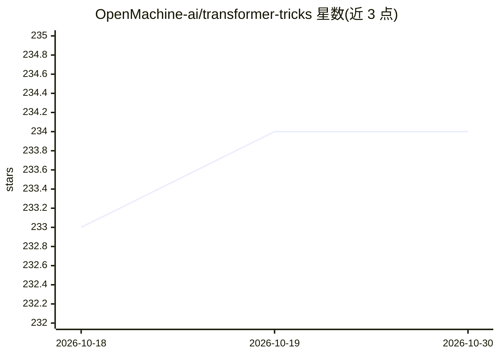

# OpenMachine-ai/transformer-tricks

⭐ 234 · TeX · MIT · 推送 2026-10-12 · [GitHub](https://github.com/OpenMachine-ai/transformer-tricks) · 组织维护

**简化并加速 Transformer 模型的技巧与工具集（PyPI 库）**

收录多项以'架构简约化'为思路的 Transformer 优化技巧：Slim attention（移除 MHA 的 V-cache）、FlashNorm（移除 RMSNorm 权重并入下一线性层）、MatShrink（进行中）、首层预计算、无残差 transformer 的 KV-weights 等，均配有论文、视频、notebook 与代码。提供 Python 包：可将任意 RMSNorm 系 HuggingFace 检查点转换为数学等价的 FlashNorm 变体并发布，支持逐层冗余 norm 消除（含 MLA 模型的部分消除路径）。适用于 LLM 推理优化方向的研究者与工程师。

## 筛选速览

| 维度 | 判定 | 备注 |
|---|---|---|
| AI 角色 | `ai-ecosystem` | LLM/agent 周边工具 |
| 许可风险 | `permissive` | MIT |
| 部署形态 | `library` | 以包/库形式分发 |
| 模型依赖 | — | README 未给出锁定关系 |
| 硬件要求 | — | 无带数字的原话,不猜 |
| 安装摩擦 | `low` | 无编译、无系统依赖或容器化 |
| 成熟度 | `idea` | |

## 能力要点

- FlashNorm：将 RMSNorm 权重折叠进下一线性层，输出与源模型数学等价
- 支持 Llama/Mistral/Gemma/Qwen/SmolLM 等 RMSNorm 检查点的 FlashNorm 转换与发布
- 冗余 norm 消除（含 DeepSeek-V2 等 MLA 模型的部分消除方案），附资格检查工具
- 每项技巧配套论文、解释视频、Jupyter/Colab notebook

## 适用场景

- 把现有 HuggingFace 检查点转换为 FlashNorm 变体以精简权重
- 研究去除冗余 norm、V-cache 等架构简约化技巧
- 复现论文配套的 notebook 实验

## 场景标签

`模型量化` · 领域:训练与推理

## 证据(README 行号)

> L6: A collection of tricks to simplify and speed up transformer models:
> L52: The `strict=True` flag folds the per-channel norm weights `g` into the following linear layer and removes the now-r

## 星数曲线

2026-10-18 233 → 2026-10-30 234（+1）

---
*卡片 v1 · prompt 1.4 · 生成 2026-10-22 · 置信度 high · 依据 README sha `1fbf12ef05a9` · [字段定义](../../DATASET.md)*
