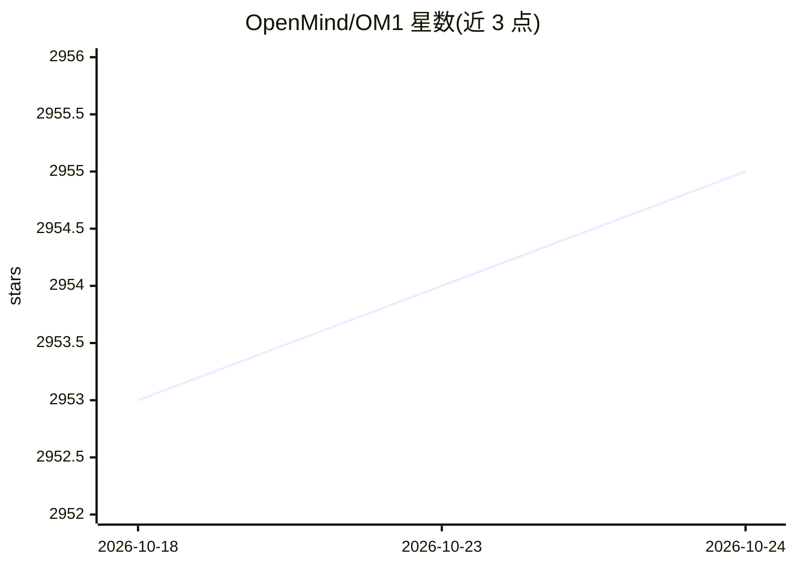

# OpenMind/OM1

⭐ 2,955 · Go · MIT · 推送 2026-10-13 · [GitHub](https://github.com/OpenMind/OM1) · [官网](https://openmind.com) · 组织维护

**面向机器人与物理设备的模块化多模态 AI agent 运行时**

OpenMind 的 OM1 是用 Go 编写的模块化 AI 运行时（早期为 Python 版，现标注弃用），用于创建和部署多模态 AI agent，覆盖人形机器人、四足机器人、手机应用、TurtleBot 4 及 Gazebo/Isaac Sim 仿真器。agent 可处理网页、摄像头、LIDAR 等输入，执行运动、自主导航与语音对话。通过插件接入 ROS2、Zenoh、CycloneDDS 硬件，预配置多家 LLM/VLM 端点，附 Prometheus/Grafana 监控栈；需要 OpenMind API key（免费额度 50 OMCU/月）方可运行。

## 筛选速览

| 维度 | 判定 | 备注 |
|---|---|---|
| AI 角色 | `ai-ecosystem` | LLM/agent 周边工具 |
| 许可风险 | `permissive` | MIT |
| 部署形态 | `desktop` | 安装包/桌面程序 |
| 模型依赖 | local-ok | 支持本地模型 |
| 硬件要求 | — | 无带数字的原话,不猜 |
| 安装摩擦 | `low` | 无编译、无系统依赖或容器化 |
| 成熟度 | — | 结构信号不足 |

## 能力要点

- Go 单二进制运行时，捆绑 Zenoh C 库，面向边缘设备低延迟部署
- 插件化硬件接入：ROS2、Zenoh、CycloneDDS、USB/串口/websockets
- 预配置 OpenAI/Anthropic/DeepSeek/Ollama 等多家 LLM 与 VLM 端点
- 附 Prometheus/Grafana 监控栈，跟踪 LLM 与 ASR 延迟指标

## 适用场景

- 给人形/四足机器人接入多模态感知与自主导航能力
- 在 Gazebo/Isaac Sim 仿真器中无硬件原型验证 agent 行为
- 通过 json5 配置组合输入与动作，快速搭建对话型或自主型机器人 agent
- 监控实时 AI 管线的 LLM 与 ASR 延迟

## 场景标签

`多模态` `Agent 框架` · 领域:Agent 开发

## 证据(README 行号)

> L7: **OpenMind's OM1 is a modular AI runtime that empowers developers to create and deploy multimodal AI agents across d
> L23: * **Pre-configured Endpoints**: Supports Text-to-Speech, multiple LLMs from OpenAI, xAI, DeepSeek, Anthropic, Meta,

## 星数曲线

2026-10-18 2,953 → 2026-10-24 2,955（+2）

---
*卡片 v1 · prompt 1.4 · 生成 2026-10-21 · 置信度 mid · 依据 README sha `d64adafc1cb3` · [字段定义](../../DATASET.md)*
