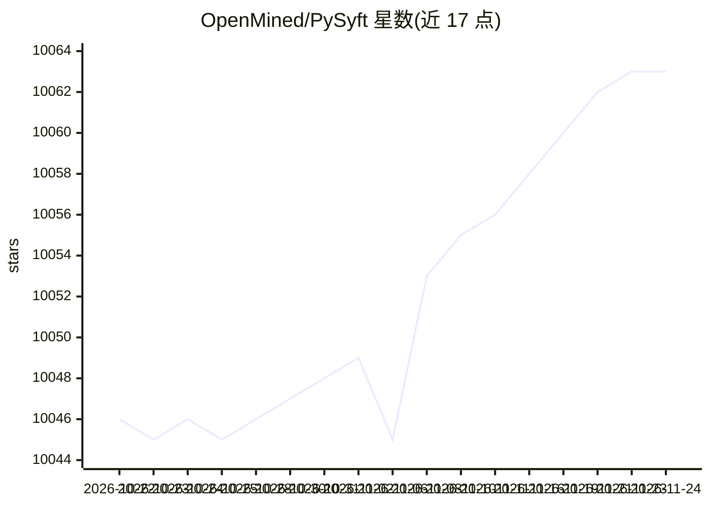

# OpenMined/PySyft

⭐ 10,063 · Python · Apache-2.0 · 推送 2026-11-21 · [GitHub](https://github.com/OpenMined/PySyft) · [官网](https://www.openmined.org/) · 组织维护

**隐私保护远程数据科学库：在他人服务器上的私有数据上运行计算**

PySyft 让数据科学家提交作业，由数据所有者审核后在私有数据上执行，仅回传批准的结果，私有数据不离开所有者机器。通过双方已有的云存储（Google Drive、Microsoft 365）或 webRTC 等 p2p 通道通信，支持签名加密、离线优先同步、逐协作者显式授权、mock/私有数据分离。由 syft 同步引擎与 syft-rds 数据集/作业客户端等多个包组成，v0.10+ 为 syft-client 的后继版本，旧 API 需 pin syft<0.10。

## 筛选速览

| 维度 | 判定 | 备注 |
|---|---|---|
| AI 角色 | `ai-ecosystem` | LLM/agent 周边工具 |
| 许可风险 | `permissive` | Apache-2.0 |
| 部署形态 | `library` | 以包/库形式分发 |
| 模型依赖 | — | README 未给出锁定关系 |
| 硬件要求 | — | 无带数字的原话,不猜 |
| 安装摩擦 | `low` | 无编译、无系统依赖或容器化 |
| 成熟度 | — | 结构信号不足 |

## 能力要点

- 作业须经数据所有者批准后才在私有数据上执行，仅共享批准结果
- 传输层基于已有云存储（Google Drive 等）与 webRTC，无需新基础设施
- mock 数据探索与私有数据执行的分离工作流
- 离线优先：对端离线也可完整工作，恢复后同步

## 适用场景

- 在不获取数据副本的前提下对合作机构的私有数据做分析
- 在 enclave 内对私有模型与私有基准做双盲评测
- 对私有 LLM 用户日志提交分析作业并取回批准结果

## 场景标签

`模型评测` · 领域:评测与运维

## 证据(README 行号)

> L13: PySyft allows data scientists run computations which are reviewed and run by data owners on private data. Users sec
> L36: - **Approved job execution** — Jobs only run after approval from the data owner(s), the approval includes access to
> L105: Built by OpenMined — building open-source technology for privacy-preserving data science and AI.

## 星数曲线

2026-10-22 10,046 → 2026-11-24 10,063（+17）

---
*卡片 v1 · prompt 1.4 · 生成 2026-11-22 · 置信度 high · 依据 README sha `dd61f0b061db` · [字段定义](../../DATASET.md)*
