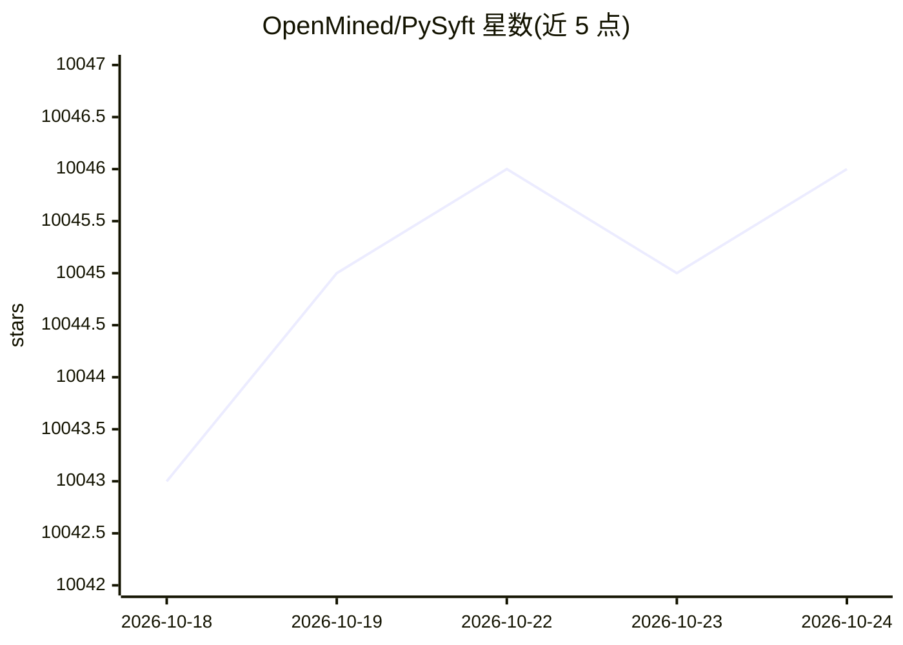

# OpenMined/PySyft

⭐ 10,045 · Python · Apache-2.0 · 推送 2026-10-24 · [GitHub](https://github.com/OpenMined/PySyft) · [官网](https://www.openmined.org/) · 组织维护

**远程数据科学库：数据不出所有者机器即可提交计算**

OpenMined 维护的隐私保护远程数据科学框架（v2）：数据科学家在模拟数据上开发分析代码，以任务形式提交给数据所有者，在沙箱化 Python 虚拟环境中对私有数据执行，仅返回经批准的结果。数据通过 Google Drive/Microsoft 365 等组织已有云存储传输，无需新建基础设施，支持离线优先同步与点对点显式授权。以 Python 包（syft/syft-rds/syft-bg 等）经 pip 安装，本地使用需配置 Google Cloud OAuth，Python 3.10+。

## 筛选速览

| 维度 | 判定 | 备注 |
|---|---|---|
| AI 角色 | `ai-ecosystem` | LLM/agent 周边工具 |
| 许可风险 | `permissive` | Apache-2.0 |
| 部署形态 | `library` | 以包/库形式分发 |
| 模型依赖 | — | README 未给出锁定关系 |
| 硬件要求 | — | 无带数字的原话,不猜 |
| 安装摩擦 | `low` | 无编译、无系统依赖或容器化 |
| 成熟度 | — | 结构信号不足 |

## 能力要点

- 私有数据不离开数据所有者机器，仅共享批准的结果
- 基于 Google Drive 等文件型传输层，可扩展至任意传输
- 任务在沙箱化 Python 虚拟环境中隔离执行
- 模拟/私有数据分离：用 mock 数据探索后提交真实任务

## 适用场景

- 在无法直接拷贝的私有数据上做分析并取回结果
- 在 enclave 中做双盲 LLM 评测（私有模型 × 私有基准）
- 对私有 LLM 用户日志提交分析任务获取批准结果

## 场景标签

`模型评测` · 领域:评测与运维

## 证据(README 行号)

> L13: PySyft lets data scientists submit computations which are run by data owners on private data — all through cloud st
> L32: - **Privacy-preserving** — Private data never leaves the data owner's machine; only approved results are shared
> L105: Built by OpenMined — building open-source technology for privacy-preserving data science and AI.

## 星数曲线

2026-10-18 10,043 → 2026-10-24 10,046（+3）

---
*卡片 v1 · prompt 1.4 · 生成 2026-10-20 · 置信度 mid · 依据 README sha `bf362f99aa6d` · [字段定义](../../DATASET.md)*
