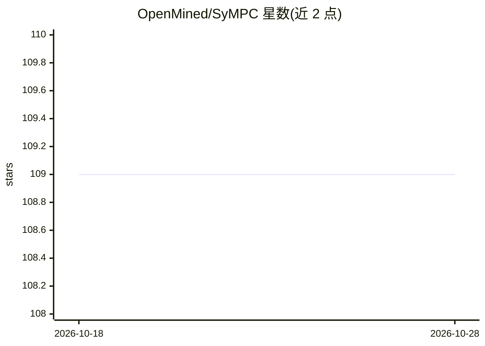

# OpenMined/SyMPC

⭐ 109 · Python · MIT · 推送 2026-02-04 · [GitHub](https://github.com/OpenMined/SyMPC) · 组织维护

**扩展 PySyft 的安全多方计算库：密文上训练与评估神经网络**

OpenMined 维护的 Python 库，为 PySyft（≥0.3）扩展 SMPC（安全多方计算）能力，支持在加密数据上计算、训练和评估神经网络。支持 ABY3、Falcon、FSS、SPDZ 四种协议，安全保证覆盖半诚实与恶意模型，参与方数量为 2 至 3 方及以上。提供 conda/pip 源码安装与 Docker 运行方式，附 introduction.ipynb 入门示例。README 声明本库仍为原型，不应在生产环境使用。

## 筛选速览

| 维度 | 判定 | 备注 |
|---|---|---|
| AI 角色 | `ai-ecosystem` | LLM/agent 周边工具 |
| 许可风险 | `permissive` | MIT |
| 部署形态 | `self-host` | docker 或自建部署 |
| 模型依赖 | — | README 未给出锁定关系 |
| 硬件要求 | — | 无带数字的原话,不猜 |
| 安装摩擦 | `low` | 无编译、无系统依赖或容器化 |
| 成熟度 | `idea` | |

## 能力要点

- 在加密数据上计算、训练与评估神经网络
- 支持 ABY3/Falcon/FSS/SPDZ 四种 SMPC 协议
- 安全保证覆盖半诚实与恶意模型（SPDZ 支持 2+ 方）
- 提供 Docker 镜像与 Jupyter 入门示例

## 适用场景

- 在 PySyft 生态中进行隐私保护的多方联合计算
- 研究不同 SMPC 协议下的安全保证与参与方配置
- 学习加密数据上的神经网络训练与评估方法

## 场景标签

`模型训练` · 领域:训练与推理

## 证据(README 行号)

> L9: SyMPC **/ˈsɪmpəθi/** is a library which extends `PySyft <https://github.com/OpenMined/PySyft>`_ ≥0.3 with SMPC suppo
> L60: |ABY3|Semi-honest, Malicious|3|
> L89: This library should not be used in a production environment because it is still a prototype.

## 星数曲线

2026-10-18 109 → 2026-10-28 109（+0）

---
*卡片 v1 · prompt 1.4 · 生成 2026-10-23 · 置信度 high · 依据 README sha `4bc40975f027` · [字段定义](../../DATASET.md)*
