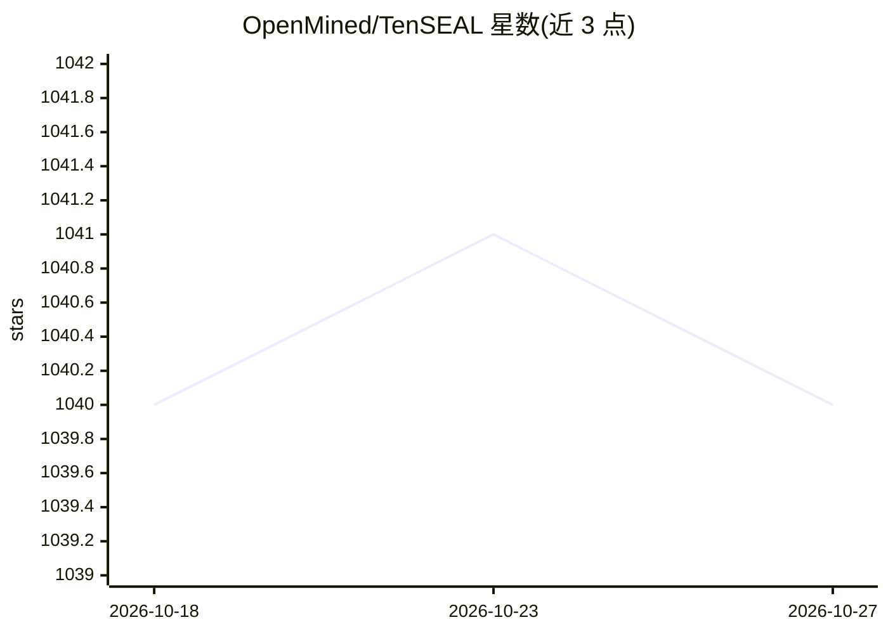

# OpenMined/TenSEAL

⭐ 1,040 · C++ · Apache-2.0 · 推送 2026-10-23 · [GitHub](https://github.com/OpenMined/TenSEAL) · 组织维护

**面向开发者的张量同态加密库：在密文上做张量运算**

TenSEAL 是构建在 Microsoft SEAL 之上的同态加密张量运算库，Python API 封装、核心运算以 C++ 实现。提供 BFV/CKKS 加解密、密文向量加/减/乘、点积与向量-矩阵乘、N 维密文张量（reshape/broadcast/transpose）及序列化，并暴露完整 SEAL API。加密参数沿用 SEAL 含义，决定安全级别与可链式运算数量。需 Python 3.11+，多平台预编译 wheel，也可源码编译。Docker Hub 镜像 2021 年后未更新，README 标注不可依赖。

## 筛选速览

| 维度 | 判定 | 备注 |
|---|---|---|
| AI 角色 | `ai-ecosystem` | LLM/agent 周边工具 |
| 许可风险 | `permissive` | Apache-2.0 |
| 部署形态 | `library` | 以包/库形式分发 |
| 模型依赖 | — | README 未给出锁定关系 |
| 硬件要求 | — | 无带数字的原话,不猜 |
| 安装摩擦 | `medium` | 含编译或系统依赖之一 |
| 成熟度 | — | 结构信号不足 |

## 能力要点

- BFV 整数与 CKKS 实数向量加解密及密文上的逐元素运算
- 点积、向量-矩阵乘与 N 维密文张量（CKKSTensor/BFVTensor）
- C++ 实现核心运算的 Python 绑定，并暴露完整 SEAL API（tenseal.sealapi）
- Linux/macOS/Windows 多平台预编译 wheel 发布

## 适用场景

- 在加密数据上训练/评估机器学习模型（如逻辑回归、MNIST 卷积）
- 隐私保护计算场景中对向量/矩阵做密文运算
- 需要通过 Python 使用 Microsoft SEAL 的加密张量接口

## 场景标签

 · 领域:隐私计算/密码学库

## 证据(README 行号)

> L16: TenSEAL is a library for doing homomorphic encryption operations on tensors, built on top of Microsoft SEAL. It pro
> L30: We show the basic operations over encrypted data, more advanced usage for machine learning applications can be foun

## 星数曲线

2026-10-18 1,040 → 2026-10-27 1,040（+0）

---
*卡片 v1 · prompt 1.4 · 生成 2026-10-21 · 置信度 high · 依据 README sha `68bb4bba4272` · [字段定义](../../DATASET.md)*
