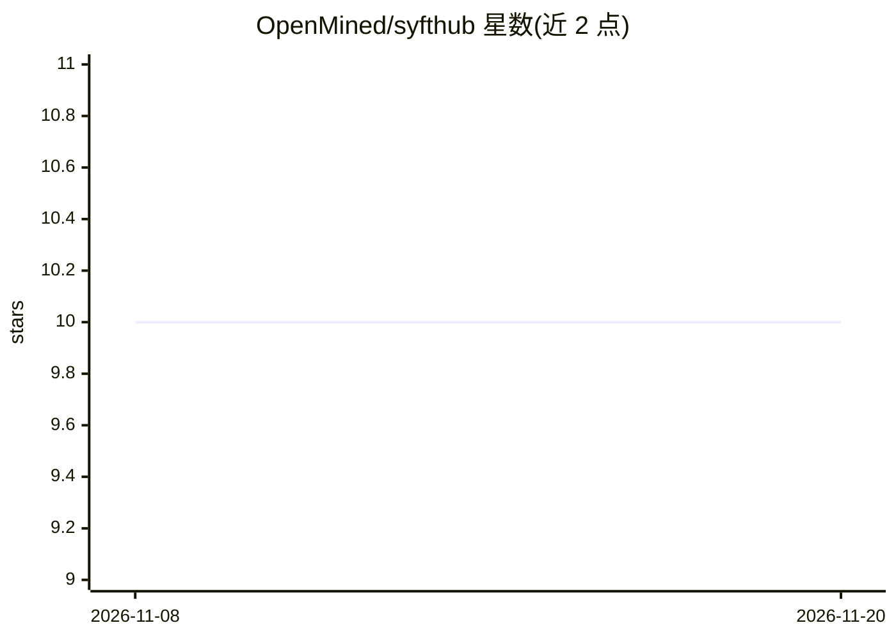

# OpenMined/syfthub

⭐ 10 · Python · Apache-2.0 · 推送 2026-11-19 · [GitHub](https://github.com/OpenMined/syfthub) · [官网](https://syfthub.openmined.org) · 组织维护

**AI/ML 端点的注册与发现平台：发布、共享、运行模型与数据源**

SyftHub 是面向 AI/ML 端点的注册与发现平台：用户可发布模型或数据源（公开/内部/私有可见性、版本控制、markdown README），浏览按热度与新鲜度排序的公共端点，并通过 web UI、Python SDK 或基于 RAG 的聊天接口调用。平台内置 RAG 聚合器跨端点编排检索与生成，支持组织内基于角色的协作与短签名令牌的联邦身份验证；SDK 提供搜索、成本/需求展示与按量计费。本地通过 git clone 后 make dev 启动全栈（nginx，端口 8080）。

## 筛选速览

| 维度 | 判定 | 备注 |
|---|---|---|
| AI 角色 | `ai-ecosystem` | LLM/agent 周边工具 |
| 许可风险 | `permissive` | Apache-2.0 |
| 部署形态 | `library` | 以包/库形式分发 |
| 模型依赖 | — | README 未给出锁定关系 |
| 硬件要求 | — | 无带数字的原话,不猜 |
| 安装摩擦 | `low` | 无编译、无系统依赖或容器化 |
| 成熟度 | — | 结构信号不足 |

## 能力要点

- 模型与数据源的注册、发现与版本化发布（三种可见性级别）
- 内置 RAG 聚合器，跨端点编排检索与生成
- 联邦身份：签发短时签名令牌供卫星服务验证用户
- Python SDK：搜索端点、展示成本与需求、按量计费

## 适用场景

- 为团队建立统一的模型与数据源共享入口
- 不搭建新基础设施即可将端点接入聊天应用
- 通过组织角色权限管理团队内的端点协作

## 场景标签

`RAG` `模型网关` · 领域:Agent 开发

## 证据(README 行号)

> L16: SyftHub is a registry and discovery platform for AI/ML endpoints. Publish a model or a data source, point friends o
> L24: - **Chat with endpoints** — built-in RAG aggregator orchestrates retrieval and generation across endpoints.
> L27: - **A Python SDK** that searches sources, shows what each one costs and needs before anything is sent, and pays met

## 星数曲线

2026-11-08 10 → 2026-11-20 10（+0）

---
*卡片 v1 · prompt 1.4 · 生成 2026-11-20 · 置信度 high · 依据 README sha `cd6673f759e2` · [字段定义](../../DATASET.md)*
