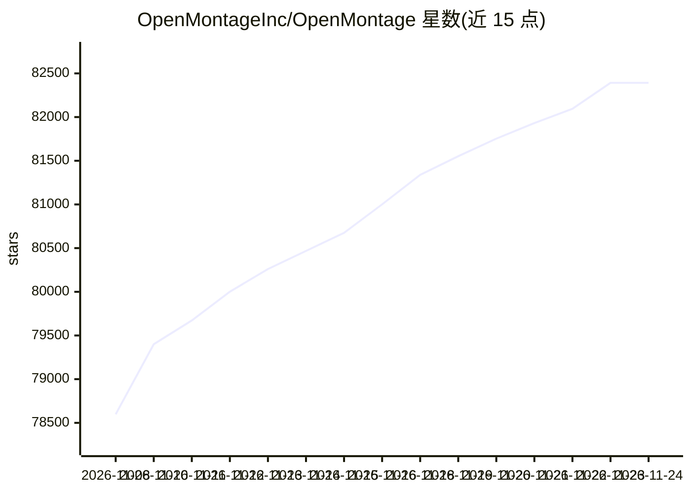

# OpenMontageInc/OpenMontage

⭐ 82,392 · Python · AGPL-3.0 · 推送 2026-11-16 · [GitHub](https://github.com/OpenMontageInc/OpenMontage) · [官网](https://www.openmontage.video/) · 组织维护 · 中文 README

**把 AI 编程助手变成完整视频制作工作室的开源系统**

面向 Claude Code、Cursor、Copilot、Windsurf、Codex 等 AI 编程助手的 agentic 视频制作系统：提供 12 条制作流水线、100+ 工具与 700+ agent 技能/制作知识文件，用自然语言驱动调研、脚本、素材生成、剪辑与合成。支持从参考视频（YouTube/TikTok/本地）反推制作方案，内置 Backlot 实时故事板与逐场景审批门，可从免费素材库检索真实 footage 剪辑成片，也可接入多种图像/视频生成模型（含 GPU 本地生成 wan2.2 等）。运行需 Python 3.10+、FFmpeg、Node.js 与一个 AI 编程助手，make setup 安装。

## 筛选速览

| 维度 | 判定 | 备注 |
|---|---|---|
| AI 角色 | `ai-ecosystem` | LLM/agent 周边工具 |
| 许可风险 | `viral` | AGPL-3.0 |
| 部署形态 | `library` | 以包/库形式分发 |
| 模型依赖 | — | README 未给出锁定关系 |
| 硬件要求 | — | 无带数字的原话,不猜 |
| 安装摩擦 | `high` | 编译与系统依赖俱全 |
| 成熟度 | — | 结构信号不足 |

## 能力要点

- 12 条制作流水线、100+ 工具、700+ agent 技能与制作知识文件
- Backlot 实时故事板：阶段可视化、逐场景审批门、运行回放
- 支持从参考视频生成差异化概念、成本估算与工具路径
- GPU 可选解锁本地视频生成（wan2.2/hunyuan/ltx2 等模型）

## 适用场景

- 用自然语言让编程助手产出完整视频（脚本、素材、配音、字幕、渲染）
- 从喜欢的 YouTube/TikTok 视频反推并制作同类内容
- 在逐场景审批门控制下用真实素材库剪辑纪录片式成片

## 场景标签

`视频生成` `图像生成` `语音合成` `AI 写作` · 领域:内容生成

## 证据(README 行号)

> L43: Turn your AI coding assistant into a full video production studio. Describe what you want in plain language — your 
> L102: Works with **Claude Code, Cursor, Copilot, Windsurf, Codex** — any AI coding assistant that can read files and run
> L178:  OpenMontage is pipeline-driven. Real work goes through `pipeline_defs/`, stage director skills in `skills/pipelin

## 星数曲线

2026-11-08 78,598 → 2026-11-24 82,392（+3,794）

---
*卡片 v1 · prompt 1.4 · 生成 2026-11-17 · 置信度 mid · 依据 README sha `f6c7c12b20f1` · [字段定义](../../DATASET.md)*
