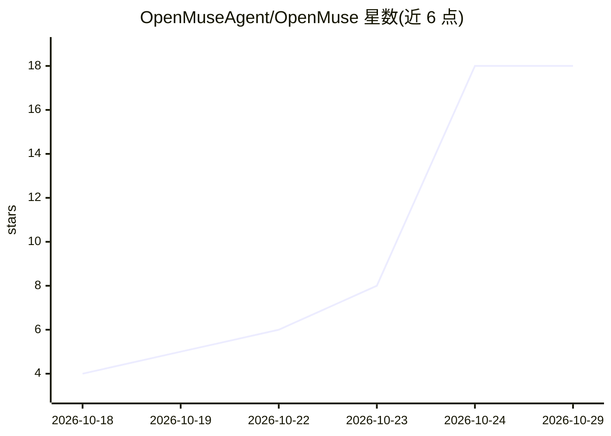

# OpenMuseAgent/OpenMuse

⭐ 18 · Python · MIT · 推送 2026-10-19 · [GitHub](https://github.com/OpenMuseAgent/OpenMuse) · [官网](https://github.com/nano-muse/nanoMuse) · 组织维护 · 中文 README

**自托管个人 AI agent：手机上的助手，执行任务而非问答**

自托管的开源个人 agent（对标 Meta Muse 形态）：一个有名字和形象的 agent，通过手机或终端对话，可执行研究、写文档、运行 shell 与 Python、收发邮件、读日历、浏览网页，并按目标长期后台工作。安全机制为核心架构：所有工具调用经 Sentinel 判定 allow/ask/deny，密钥存加密 vault 不进入模型，Linux 上命令跑在 bubblewrap 沙箱。支持任意 OpenAI 兼容模型（含 Ollama 本地模型），提供 pip 包、Web App（React）、Android App 与 Docker 部署。注意：本仓库已迁移并停止维护，作为 0.1.0–0.6.0 归档。

## 筛选速览

| 维度 | 判定 | 备注 |
|---|---|---|
| AI 角色 | `ai-native` | 本体是模型或模型工具 |
| 许可风险 | `permissive` | MIT |
| 部署形态 | `self-host` | docker 或自建部署 |
| 模型依赖 | local-ok | 支持本地模型 |
| 硬件要求 | — | 无带数字的原话,不猜 |
| 安装摩擦 | `low` | 无编译、无系统依赖或容器化 |
| 成熟度 | — | 结构信号不足 |

## 能力要点

- 执行型个人 agent：shell/Python/邮件/日历/浏览，按目标后台工作
- Sentinel 安全层：allow/ask/deny 规则、污点追踪、egress 白名单、审计日志
- 加密密钥 vault，模型不可见密钥，输出自动脱敏
- 任意 OpenAI 兼容模型（DeepSeek/OpenAI/Ollama/vLLM 等）

## 适用场景

- 在手机上让 agent 代为执行任务并跟踪长期目标
- 自托管替代云端个人助手，数据留在本机
- 通过 Sentinel 审批机制安全地让 agent 执行敏感操作

## 场景标签

`AI 助手` · 领域:对话与助手

## 证据(README 行号)

> L17: 🧸 **OpenMuse** is an open-source, self-hosted personal agent in the shape of Meta's Muse: one agent with a name and
> L41: - research, write pages and documents, run shell commands and Python, send mail, read your calendar and your contac

## 星数曲线

2026-10-18 4 → 2026-10-29 18（+14）

---
*卡片 v1 · prompt 1.4 · 生成 2026-10-29 · 置信度 high · 依据 README sha `b54d9311cd55` · [字段定义](../../DATASET.md)*
