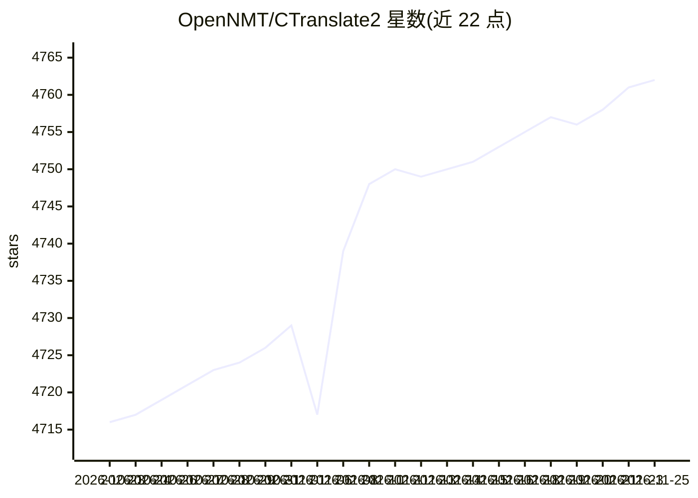

# OpenNMT/CTranslate2

⭐ 4,762 · C++ · MIT · 推送 2026-11-22 · [GitHub](https://github.com/OpenNMT/CTranslate2) · [官网](https://opennmt.net/CTranslate2) · 组织维护

**给开发者用的 Transformer 模型高效推理引擎（C++/Python）**

C++ 与 Python 库，通过自定义运行时对 Transformer 模型做量化、层融合、批重排等优化，在 CPU 和 GPU 上运行推理并降低内存占用。支持 encoder-decoder、decoder-only、encoder-only 及实验性 TTS 模型，需先将各框架模型转换为优化的模型格式。定位生产环境，提供向后兼容保证，暴露 Python 与 C++ API，支持张量并行与交互式解码。

## 筛选速览

| 维度 | 判定 | 备注 |
|---|---|---|
| AI 角色 | `ai-ecosystem` | LLM/agent 周边工具 |
| 许可风险 | `permissive` | MIT |
| 部署形态 | `desktop` | 安装包/桌面程序 |
| 模型依赖 | — | README 未给出锁定关系 |
| 硬件要求 | — | 无带数字的原话,不猜 |
| 安装摩擦 | `medium` | 含编译或系统依赖之一 |
| 成熟度 | — | 结构信号不足 |

## 能力要点

- 支持 FP16/BF16/INT16/INT8/AWQ INT4 多种量化，模型磁盘体积可缩小 4 倍
- 支持 x86-64 与 AArch64/ARM64，集成 Intel MKL、oneDNN、OpenBLAS、Ruy、Apple Accelerate 后端
- 提供 Converter 转换 OpenNMT-py/tf、Fairseq、Marian、OPUS-MT、Transformers 等框架模型
- 支持多 GPU/CPU 核的并行异步执行与超大模型的张量并行

## 适用场景

- 把训练好的翻译/生成模型转换为优化格式后部署推理服务
- 在 CPU 或 GPU 上以更低内存运行 Llama、Mistral、Whisper 等模型
- 需要 C++/Python API 集成推理能力到现有系统
- 跨 x86-64 与 ARM64 平台部署 Transformer 推理

## 场景标签

`推理引擎` `模型量化` · 领域:训练与推理

## 证据(README 行号)

> L5: CTranslate2 is a C++ and Python library for efficient inference with Transformer models.
> L7: The project implements a custom runtime that applies many performance optimization techniques such as weights quanti

## 星数曲线

2026-10-23 4,716 → 2026-11-25 4,762（+46）

---
*卡片 v1 · prompt 1.4 · 生成 2026-11-22 · 置信度 high · 依据 README sha `47800f4c7d8c` · [字段定义](../../DATASET.md)*
