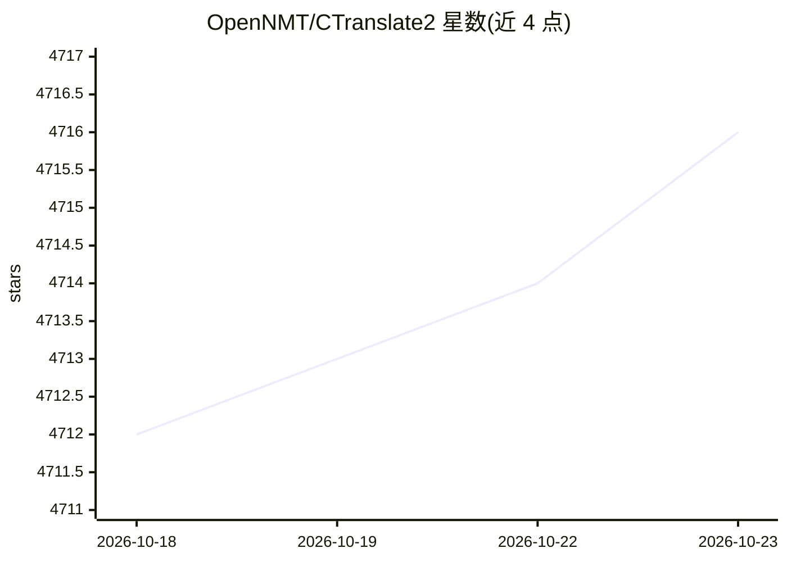

# OpenNMT/CTranslate2

⭐ 4,716 · C++ · MIT · 推送 2026-10-22 · [GitHub](https://github.com/OpenNMT/CTranslate2) · [官网](https://opennmt.net/CTranslate2) · 组织维护

**Transformer 模型的高效推理运行时库（C++/Python）**

面向生产环境的 Transformer 模型自定义推理运行时：通过权重量化（FP16/BF16/INT16/INT8/INT4 AWQ）、层融合、批重排、缓存分配等优化手段降低 CPU 与 GPU 上的内存占用并加速推理。支持编码器-解码器（T5、Whisper 等）、仅解码器（Llama、Mistral、Qwen2 等）与仅编码器（BERT 等）模型，需先从 OpenNMT-py/tf、Fairseq、Marian、Transformers 等框架转换为专有格式。提供 Python/C++ API，支持多后端 CPU 架构与张量并行多 GPU 推理，配套 OpenAI 兼容 REST 的 ctranslate2-web-server。

## 筛选速览

| 维度 | 判定 | 备注 |
|---|---|---|
| AI 角色 | `ai-ecosystem` | LLM/agent 周边工具 |
| 许可风险 | `permissive` | MIT |
| 部署形态 | `desktop` | 安装包/桌面程序 |
| 模型依赖 | — | README 未给出锁定关系 |
| 硬件要求 | — | 无带数字的原话,不猜 |
| 安装摩擦 | `medium` | 含编译或系统依赖之一 |
| 成熟度 | — | 结构信号不足 |

## 能力要点

- 权重量化支持 FP16/BF16/INT16/INT8 与 AWQ INT4
- 支持 x86-64 与 AArch64/ARM64，自动 CPU 检测选择指令集（AVX/AVX2 等）
- 多 GPU 张量并行的分布式推理
- 配套 OpenAI 兼容 REST API 的 web server

## 适用场景

- 将训练好的翻译或生成模型部署为低资源占用推理服务
- 量化压缩模型以减小磁盘与内存占用
- 在 CPU/GPU 集群上做并行批量翻译或文本生成

## 场景标签

`推理引擎` · 领域:训练与推理

## 证据(README 行号)

> L5: CTranslate2 is a C++ and Python library for efficient inference with Transformer models.
> L7: The project implements a custom runtime that applies many performance optimization techniques such as weights quanti

## 星数曲线

2026-10-18 4,712 → 2026-10-23 4,716（+4）

---
*卡片 v1 · prompt 1.4 · 生成 2026-10-20 · 置信度 high · 依据 README sha `07e327249540` · [字段定义](../../DATASET.md)*
