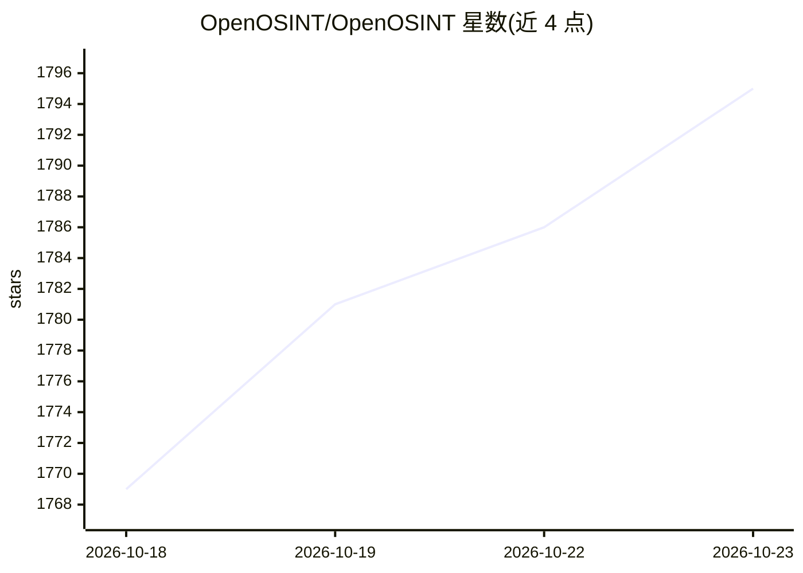

# OpenOSINT/OpenOSINT

⭐ 1,795 · Python · MIT · 推送 2026-10-22 · [GitHub](https://github.com/OpenOSINT/OpenOSINT) · [官网](https://openosint.tech) · 组织维护

**面向安全研究者的 OSINT 代理：21 种调查工具+自然语言/MCP 驱动**

为安全研究人员和分析师提供的开源情报（OSINT）引擎：将 21 种调查工具（WHOIS、DNS、Shodan、VirusTotal、Censys、GitHub、泄露查询等）置于自然语言接口之后，由 AI 代理自主选择并串联工具；提供 REPL、CLI、MCP 服务器与浏览器 Web UI 四种形态。支持 Anthropic Claude（默认）、本地 Ollama 或任意 OpenAI 兼容端点。默认被动模式：触碰目标或高噪音的工具默认不启用、不向模型暴露；每次请求受工具调用数上限约束。声明仅限合法授权使用。

## 筛选速览

| 维度 | 判定 | 备注 |
|---|---|---|
| AI 角色 | `ai-native` | 本体是模型或模型工具 |
| 许可风险 | `permissive` | MIT |
| 部署形态 | `self-host` | docker 或自建部署 |
| 模型依赖 | local-ok | 支持本地模型 |
| 硬件要求 | — | 无带数字的原话,不猜 |
| 安装摩擦 | `low` | 无编译、无系统依赖或容器化 |
| 成熟度 | — | 结构信号不足 |

## 能力要点

- 21 种模块化调查工具，代理按发现自动串联执行
- 原生 MCP 服务器，任意 MCP 兼容客户端可直接驱动
- 默认被动模式：触碰目标/高噪音工具默认关闭且不出现在 tools/list
- 每次请求设工具调用上限（默认 15），并自动生成 PDF/Markdown 报告

## 适用场景

- 我对邮箱、用户名、域名、IP 等目标做被动开源情报调查
- 我通过 Claude 等 MCP 客户端直接调用这套 OSINT 工具
- 我在授权的安全研究中生成可溯源的调查报告（含工具调用记录）

## 场景标签

`网络安全` · 领域:学习与行业

## 证据(README 行号)

> L5:  An OSINT (Open Source Intelligence) agent for security researchers and analysts: 21 investigation tools behind a na
> L62: |Three AI backends|Anthropic Claude (default), local Ollama, or any OpenAI-compatible endpoint (LiteLLM, vLLM, LM S

## 星数曲线

2026-10-18 1,769 → 2026-10-23 1,795（+26）

---
*卡片 v1 · prompt 1.4 · 生成 2026-10-21 · 置信度 mid · 依据 README sha `763de0e5dea3` · [字段定义](../../DATASET.md)*
