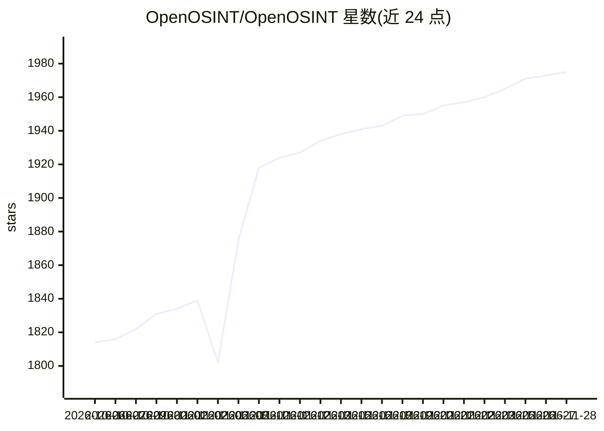

# OpenOSINT/OpenOSINT

⭐ 1,975 · Python · MIT · 推送 2026-11-27 · [GitHub](https://github.com/OpenOSINT/OpenOSINT) · [官网](https://openosint.tech) · 组织维护

**给调查员与安全研究者的自然语言 OSINT agent，集成 21 个公开情报工具**

面向调查员和安全研究人员的开源 OSINT agent：将 21 个公开来源查询工具置于自然语言聊天界面之后，提供 Web UI（流式聊天、3D 地球、实体图）、REPL、CLI 与 MCP server。每个发现引用产生它的工具调用；默认仅启用被动工具，触碰目标的主动扫描需 --allow-active 显式开启。基础命令无需 API key，部分工具需自备密钥，Sherlock 等 4 个工具需自行安装二进制。

## 筛选速览

| 维度 | 判定 | 备注 |
|---|---|---|
| AI 角色 | `ai-native` | 本体是模型或模型工具 |
| 许可风险 | `permissive` | MIT |
| 部署形态 | `self-host` | docker 或自建部署 |
| 模型依赖 | — | README 未给出锁定关系 |
| 硬件要求 | — | 无带数字的原话,不猜 |
| 安装摩擦 | `low` | 无编译、无系统依赖或容器化 |
| 成熟度 | — | 结构信号不足 |

## 能力要点

- 21 个 OSINT 工具经自然语言与 MCP 调用，结论逐条引用来源
- 默认被动模式：主动工具需 opt-in 且不列入 MCP tools/list
- Web UI 含流式聊天、新闻地球与 FollowTheMoney 实体图
- exposure 命令对邮件认证、TLS、注册信息打 A-F 分级

## 适用场景

- 对域名或公司做被动情报收集与暴露面评估
- 在 Claude Code/Cursor 等 MCP 客户端中调用 OSINT 工具
- 生成带来源引用的调查报告用于授权安全评估

## 场景标签

`网络安全` · 领域:学习与行业

## 证据(README 行号)

> L2:  OpenOSINT is an open-source OSINT agent for investigators and security researchers: 21 public-source tools behind a
> L84: Agents and MCP clients are only offered tools that query third-party sources or compute locally. Anything that touc

## 星数曲线

2026-10-26 1,814 → 2026-11-28 1,975（+161）

---
*卡片 v1 · prompt 1.4 · 生成 2026-11-28 · 置信度 high · 依据 README sha `22af9898bd6d` · [字段定义](../../DATASET.md)*
