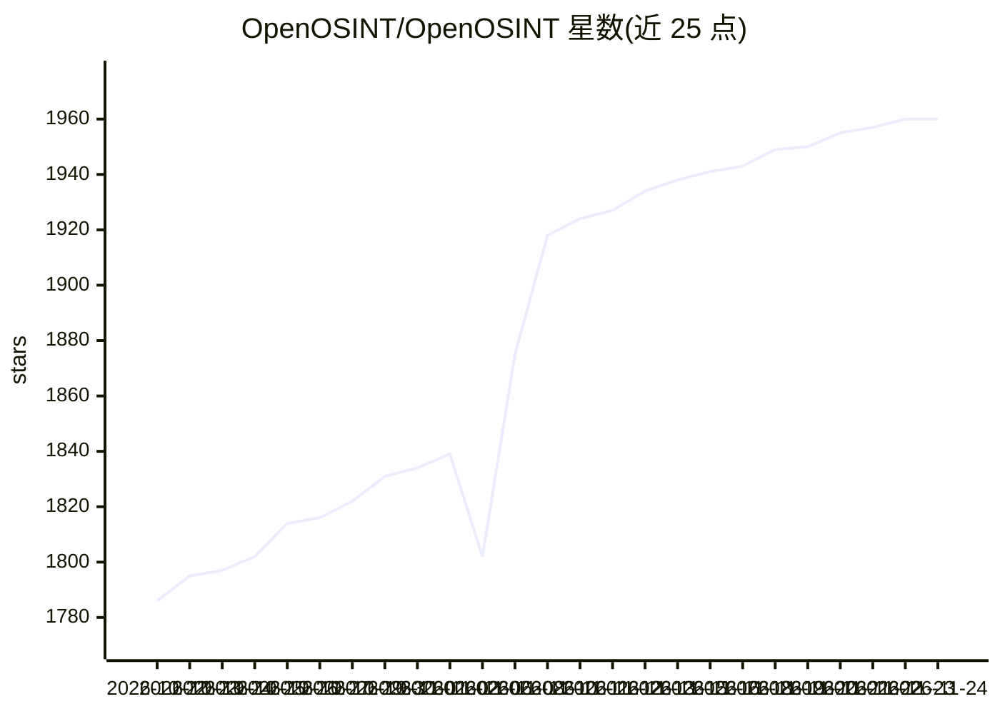

# OpenOSINT/OpenOSINT

⭐ 1,960 · Python · MIT · 推送 2026-11-15 · [GitHub](https://github.com/OpenOSINT/OpenOSINT) · [官网](https://openosint.tech) · 组织维护

**面向调查人员的自然语言 OSINT agent（21 个公开来源工具+MCP）**

开源 OSINT agent，把 21 个公开来源查询工具封装在自然语言聊天界面之后，输出带来源引用的调查结论；提供 Web UI（聊天、3D 地球、实体图谱）、REPL、MCP server 和 Claude Code 插件四种形态。默认仅启用被动查询工具，接触目标的主动操作需 --allow-active 显式开启；大部分工具免 API key 即可启动，部分工具需自行配置密钥。Python 3.10+，支持 pip/uvx/Docker 安装。

## 筛选速览

| 维度 | 判定 | 备注 |
|---|---|---|
| AI 角色 | `ai-native` | 本体是模型或模型工具 |
| 许可风险 | `permissive` | MIT |
| 部署形态 | `self-host` | docker 或自建部署 |
| 模型依赖 | — | README 未给出锁定关系 |
| 硬件要求 | — | 无带数字的原话,不猜 |
| 安装摩擦 | `low` | 无编译、无系统依赖或容器化 |
| 成熟度 | — | 结构信号不足 |

## 能力要点

- 21 个公开来源查询工具，每条结论附工具调用出处
- MCP server 兼容 Claude Desktop/Claude Code/Cursor 等 MCP 客户端
- 默认被动查询，主动扫描需显式 --allow-active 开启
- Web UI 含流式聊天、新闻地球仪与 FollowTheMoney 实体图谱

## 适用场景

- 对域名/IP/公司做被动情报收集与暴露面评估
- 在 Claude Code 或 MCP 客户端中以对话方式发起 OSINT 调查
- 查看带图谱与地球仪可视化的调查结果并逐点下钻

## 场景标签

`网络安全` `AI 助手` · 领域:对话与助手

## 证据(README 行号)

> L2:  OpenOSINT is an open-source OSINT agent for investigators and security researchers: 21 public-source tools behind a
> L76: Tools run as real Python code and every finding cites the call that produced it. Compared with SpiderFoot, OpenOSIN

## 星数曲线

2026-10-22 1,786 → 2026-11-24 1,960（+174）

---
*卡片 v1 · prompt 1.4 · 生成 2026-11-23 · 置信度 mid · 依据 README sha `03324ed6c932` · [字段定义](../../DATASET.md)*
