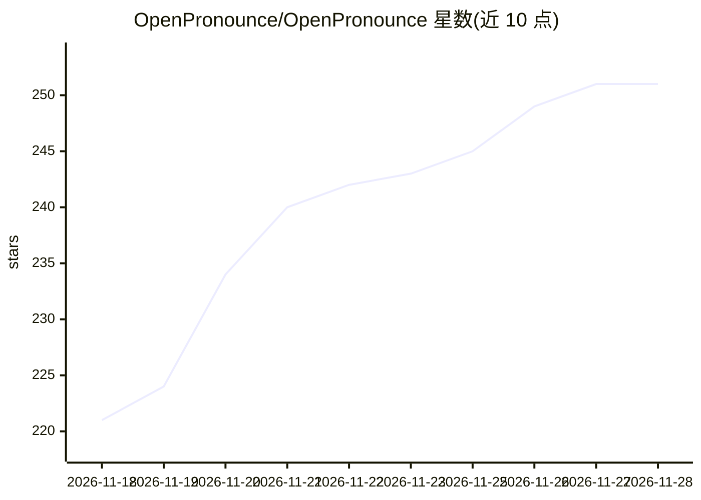

# OpenPronounce/OpenPronounce

⭐ 251 · Python · AGPL-3.0 · 推送 2026-11-27 · [GitHub](https://github.com/OpenPronounce/OpenPronounce) · [官网](https://openpronounce.github.io) · 个人维护

**自托管发音评估工具：给录音打分并找出读错的单词**

开源、可自托管的音素级发音评估工具：输入录音，输出总体、准确度、流利度、韵律四项分数及读错的单词与实际听到的音，支持已知句子和自由语音两种模式，覆盖英语及法语等 6 种语言。本地 CPU 即可运行，语音数据不出本机服务器。CLI、Python API、Web demo 与 HTTP API 三种使用方式；首个非英语语言需另装 espeak-ng，首次运行下载两个各 1.2 GB 的 Wav2Vec2 检查点。AGPL 许可，闭源商用需购买商业许可。

## 筛选速览

| 维度 | 判定 | 备注 |
|---|---|---|
| AI 角色 | `ai-native` | 本体是模型或模型工具 |
| 许可风险 | `dual` | AGPL-3.0 |
| 部署形态 | `self-host` | docker 或自建部署 |
| 模型依赖 | — | README 未给出锁定关系 |
| 硬件要求 | — | 无带数字的原话,不猜 |
| 安装摩擦 | `low` | 无编译、无系统依赖或容器化 |
| 成熟度 | — | 结构信号不足 |

## 能力要点

- 音素级评估：定位读错的词并给出实际发音
- 英语等 7 种语言，支持朗读与自由语音模式
- CLI、Python API、Web demo、HTTP API 多种接入方式
- 提供 openpronounce-evaluate 在自有标注数据上测量相关性

## 适用场景

- 语言学习应用集成发音打分
- 自托管教学平台评估学生口语
- 在自有标注数据上验证评分一致性

## 场景标签

`语音识别` · 领域:感知与多模态

## 证据(README 行号)

> L3:  Open-source, phoneme-level pronunciation assessment.
> L4:  Give it a recording. Get the scores a human rater would give (overall, accuracy, fluency, prosody) and the words th

## 星数曲线

2026-11-18 221 → 2026-11-28 251（+30）

---
*卡片 v1 · prompt 1.4 · 生成 2026-11-19 · 置信度 high · 依据 README sha `46b81782f8b3` · [字段定义](../../DATASET.md)*
