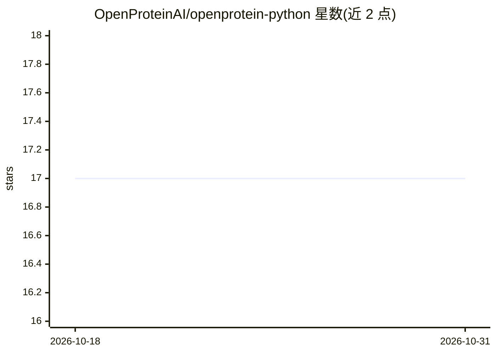

# OpenProteinAI/openprotein-python

⭐ 17 · Python · NOASSERTION · 推送 2026-08-22 · [GitHub](https://github.com/OpenProteinAI/openprotein-python) · [官网](https://openprotein.ai) · 组织维护

**OpenProtein.AI REST API 的 Python 客户端，用于蛋白质建模任务**

由 OpenProtein.AI 提供的官方 Python 接口库，封装其 REST API：用户以账号凭据建立会话，通过 Future 异步对象追踪任务状态与获取结果，支持任务列表、查询与恢复。内置 PoET 模型接口，可对蛋白质序列打分、单点变异打分与生成序列，并可取回 prompt/MSA/种子序列。计算依赖远端 API 完成，本地仅做调用编排，需 OpenProtein.AI 账号。面向从事蛋白质分析与建模的科研与开发用户。

## 筛选速览

| 维度 | 判定 | 备注 |
|---|---|---|
| AI 角色 | `ai-ecosystem` | LLM/agent 周边工具 |
| 许可风险 | `none` | NOASSERTION |
| 部署形态 | `library` | 以包/库形式分发 |
| 模型依赖 | — | README 未给出锁定关系 |
| 硬件要求 | — | 无带数字的原话,不猜 |
| 安装摩擦 | `low` | 无编译、无系统依赖或容器化 |
| 成熟度 | — | 结构信号不足 |

## 能力要点

- Future 异步对象追踪任务状态（refresh/done/wait/get）
- PoET 接口支持序列打分、单点变异打分与序列生成
- 任务列表、按 ID 查询与恢复历史任务的 Jobs 接口
- 可取回 prompt、MSA、seed 序列等任务输入

## 适用场景

- 用 Python 脚本调用 OpenProtein.AI 做蛋白质序列打分与生成
- 批量提交建模任务并异步轮询获取结果
- 恢复或查看历史训练与分析任务

## 场景标签

`科研工具` · 领域:学习与行业

## 证据(README 行号)

> L6: The OpenProtein.AI Python Interface provides a user-friendly library to interact with the OpenProtein.AI REST API, e

## 星数曲线

2026-10-18 17 → 2026-10-31 17（+0）

---
*卡片 v1 · prompt 1.4 · 生成 2026-10-30 · 置信度 high · 依据 README sha `95ef904ce660` · [字段定义](../../DATASET.md)*
