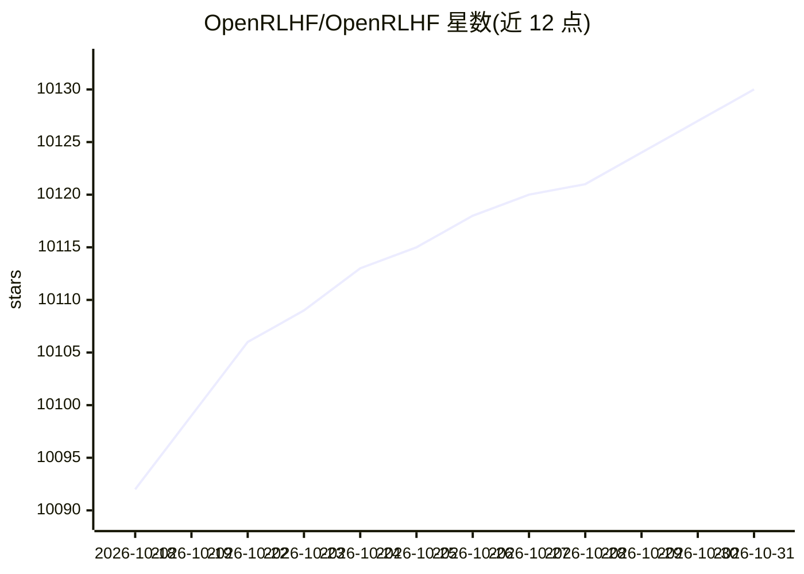

# OpenRLHF/OpenRLHF

⭐ 10,130 · Python · Apache-2.0 · 推送 2026-10-05 · [GitHub](https://github.com/OpenRLHF/OpenRLHF) · [官网](https://openrlhf.readthedocs.io/) · 组织维护 · 中文 README

**面向 LLM/VLM 的分布式 RLHF 训练框架（Ray + vLLM）**

基于 Ray + vLLM + DeepSpeed 构建的开源 RLHF 训练框架，提供 SFT、DPO、奖励模型训练与 PPO/REINFORCE++/GRPO/RLOO 等多种 RL 算法，支持单轮与多轮 agent 训练模式（统一 token-in-token-out 执行管线）。通过混合引擎调度让模型与 vLLM 引擎共享 GPU，支持 70B+ 参数模型、LoRA/QLoRA、MoE、多节点 SLURM 训练。面向需要大规模对齐训练 LLM/VLM 的研究者和工程师，依赖 GPU 分布式环境（NCCL/CUDA IPC）。

## 筛选速览

| 维度 | 判定 | 备注 |
|---|---|---|
| AI 角色 | `ai-ecosystem` | LLM/agent 周边工具 |
| 许可风险 | `permissive` | Apache-2.0 |
| 部署形态 | `self-host` | docker 或自建部署 |
| 模型依赖 | local-ok | 支持本地模型 |
| 硬件要求 | — | 无带数字的原话,不猜 |
| 安装摩擦 | `low` | 无编译、无系统依赖或容器化 |
| 成熟度 | — | 结构信号不足 |

## 能力要点

- 实现 PPO、REINFORCE++/baseline、GRPO、RLOO、Dr.GRPO、FlashREINFORCE 等 RL 算法
- Ray 分布式调度 + vLLM 生成加速 + DeepSpeed ZeRO-3 训练，混合引擎共享 GPU
- 单轮/多轮 agent 训练统一接口，算法与执行模式解耦
- 支持 VLM 视觉语言模型 RL、LoRA/QLoRA、MoE、Muon 优化器与多节点训练

## 适用场景

- 对大模型做 RLHF/RLVR 对齐训练
- 训练多轮 agent 或视觉语言模型
- 在多 GPU/多节点集群上扩展 RL 训练
- 复现 DeepSeek-R1 等训练方案

## 场景标签

`强化学习` `微调` `模型训练` · 领域:训练与推理

## 证据(README 行号)

> L26: OpenRLHF is **the first** high-performance, production-ready open-source RLHF framework that combines **Ray + vLLM 
> L70: OpenRLHF is **the first RLHF framework** built on Ray + vLLM distributed architecture, orchestrating multiple compo
> L133: OpenRLHF implements **PPO, REINFORCE++, REINFORCE++-baseline, GRPO, RLOO** with advanced optimization tricks inspi

## 星数曲线

2026-10-18 10,092 → 2026-10-31 10,130（+38）

---
*卡片 v1 · prompt 1.4 · 生成 2026-10-20 · 置信度 high · 依据 README sha `28e4068951ce` · [字段定义](../../DATASET.md)*
