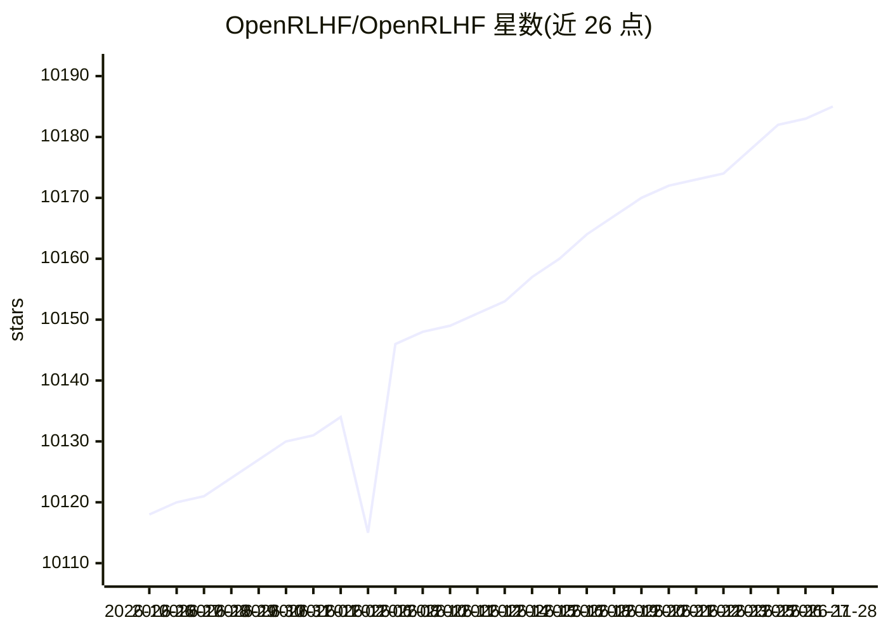

# OpenRLHF/OpenRLHF

⭐ 10,185 · Python · Apache-2.0 · 推送 2026-11-27 · [GitHub](https://github.com/OpenRLHF/OpenRLHF) · [官网](https://openrlhf.readthedocs.io/) · 组织维护 · 中文 README

**面向研究者的基于 Ray+vLLM 的 RLHF 训练框架**

OpenRLHF 是基于 Ray 与 vLLM 分布式架构的 RLHF 训练框架，将 Actor/Reward/Reference/Critic 模型分置于不同 GPU，并通过混合引擎调度共享 GPU 资源。采用统一的 agent 执行管线（token-in-token-out），实现 PPO、REINFORCE++、GRPO、RLOO、FlashREINFORCE 等算法与单轮/多轮执行模式的解耦。支持 SFT、DPO、奖励模型训练、VLM RLHF、LoRA/QLoRA、MoE、多节点 SLURM 训练。面向需要训练和对齐大语言模型的研究者与工程师。

## 筛选速览

| 维度 | 判定 | 备注 |
|---|---|---|
| AI 角色 | `ai-ecosystem` | LLM/agent 周边工具 |
| 许可风险 | `permissive` | Apache-2.0 |
| 部署形态 | `self-host` | docker 或自建部署 |
| 模型依赖 | local-ok | 支持本地模型 |
| 硬件要求 | — | 无带数字的原话,不猜 |
| 安装摩擦 | `low` | 无编译、无系统依赖或容器化 |
| 成熟度 | `idea` | |

## 能力要点

- 基于 Ray+vLLM+DeepSpeed 的分布式 RLHF 训练架构，支持 70B+ 参数模型
- 统一 agent 执行范式：token-in-token-out，单轮/多轮模式与 RL 算法正交解耦
- 实现 PPO、REINFORCE++、GRPO、RLOO、FlashREINFORCE 等多种 RL 算法
- 支持 VLM RLHF、LoRA/QLoRA、MoE、异步训练与 DAPO 动态过滤

## 适用场景

- 对大语言模型做 RLHF/DPO 对齐训练
- 训练推理模型（RLVR 场景，REINFORCE++-baseline）
- 带图像反馈的多轮 VLM 强化学习训练
- 构建基于 OpenAI 兼容服务器的 agentic RL 训练流程

## 场景标签

`微调` `强化学习` · 领域:训练与推理

## 证据(README 行号)

> L26: OpenRLHF is **the first** high-performance, production-ready open-source RLHF framework that combines **Ray + vLLM 
> L68: ## 🏗️ Architecture Foundation: Ray + vLLM Distribution
> L133: OpenRLHF implements **PPO, REINFORCE++, REINFORCE++-baseline, GRPO, RLOO** with advanced optimization tricks inspi

## 星数曲线

2026-10-26 10,118 → 2026-11-28 10,185（+67）

---
*卡片 v1 · prompt 1.4 · 生成 2026-11-28 · 置信度 high · 依据 README sha `13ffc38aa355` · [字段定义](../../DATASET.md)*
