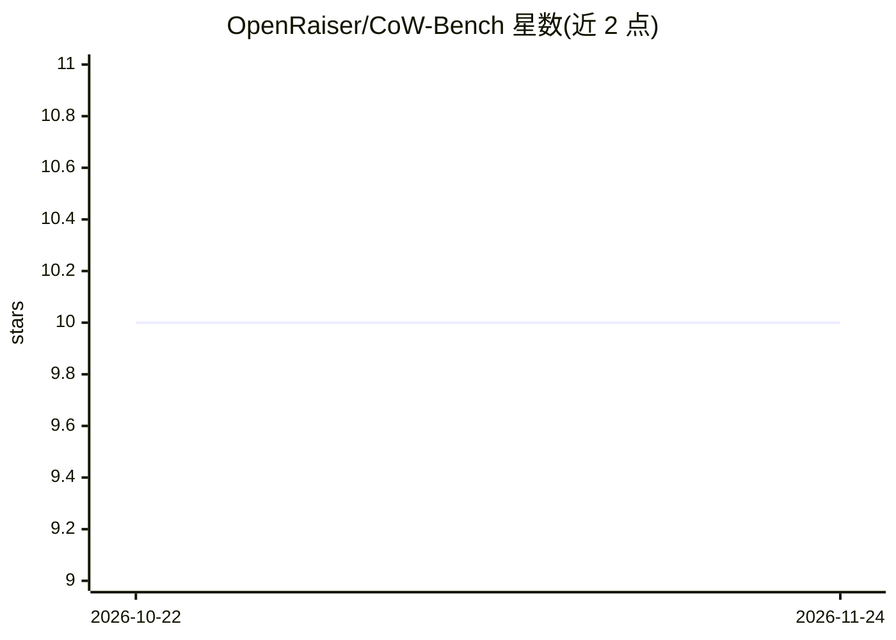

# OpenRaiser/CoW-Bench

⭐ 10 · HTML · 推送 2026-03-26 · [GitHub](https://github.com/OpenRaiser/CoW-Bench) · [官网](https://openraiser.github.io/CoW-Bench/) · 组织维护

**通用世界模型一致性评测基准：提示集与各模型输出展示**

CoW-Bench 是一个针对通用世界模型的评测基准与排行榜仓库，围绕"一致性三要素"组织测试用例。README 以目录形式展示三类测试维度：Subj-Attr（主体属性）、Local-Edit（局部编辑）、Multi-Const（多重约束），以及 ModalxSpatial（语义×空间）下的 Sem-MV（多视角）用例；每个用例给出提示文本与输入图像，并陈列 16 个图像/视频生成模型（GPT image、Nano Banana、Seedream、Veo、sora、Wan2.2、BAGEL、HunyuanVideo、Qwen-Image 等）的输出结果。面向研究者在统一提示下比较各模型的生成一致性表现。

## 筛选速览

| 维度 | 判定 | 备注 |
|---|---|---|
| AI 角色 | `ai-knowledge` | 知识聚合/清单类 |
| 许可风险 | `none` | — |
| 部署形态 | `None` |  |
| 模型依赖 | — | README 未给出锁定关系 |
| 硬件要求 | — | 无带数字的原话,不猜 |
| 安装摩擦 | `low` | 无编译、无系统依赖或容器化 |
| 成熟度 | — | 结构信号不足 |

## 能力要点

- 按 Subj-Attr / Local-Edit / Multi-Const / Sem-MV 等维度组织的评测提示集
- 每个用例附带提示文本、输入图像与 16 个模型的输出展示
- 覆盖图像生成与视频生成两类模型

## 适用场景

- 在统一提示下对比不同图像/视频生成模型的一致性表现
- 为世界模型评测研究选取测试用例与参考输出

## 场景标签

`模型评测` · 领域:评测与运维

## 证据(README 行号)

> L1: # COW-BENCH
> L5: ## **Modal**
> L7: ### Subj-Attr
> L403: ## **ModalxSpatial**

## 星数曲线

2026-10-22 10 → 2026-11-24 10（+0）

---
*卡片 v1 · prompt 1.4 · 生成 2026-11-20 · 置信度 high · 依据 README sha `c6be22983472` · [字段定义](../../DATASET.md)*
