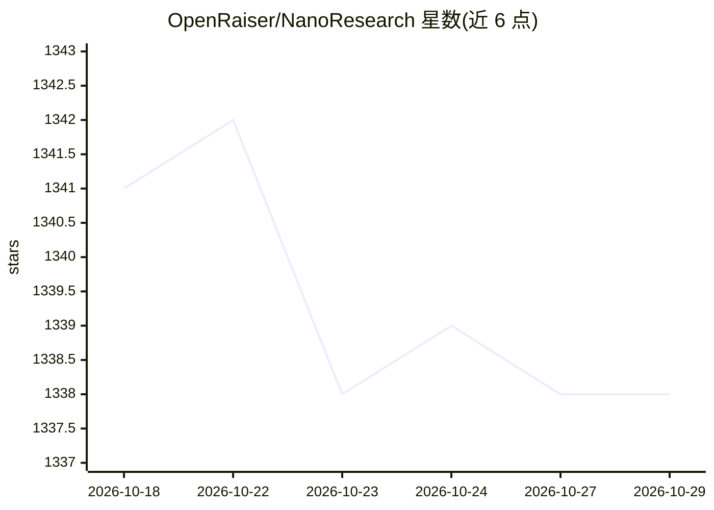

# OpenRaiser/NanoResearch

⭐ 1,338 · Python · MIT · 推送 2026-10-09 · [GitHub](https://github.com/OpenRaiser/NanoResearch) · 组织维护 · 中文 README

**端到端自主 AI 科研引擎：从课题到实验与 LaTeX 论文全自动**

面向科研用户的自主科研流水线：输入研究课题后，系统经 9 个阶段（文献检索、实验设计、代码生成、实验执行、结果分析、图表生成、论文撰写、审稿）产出论文 PDF/LaTeX 及完整工作空间。EXECUTION 阶段可在本地 GPU 或 SLURM 集群上真实运行训练，论文数据来自实际实验而非模型生成。基于 OpenAI 兼容端点，支持按阶段路由不同模型，可断点续跑；另有 Claude Code 集成模式、Codex 入口与飞书机器人。README 提示生成论文应视为初稿，投稿前需人工审阅。

## 筛选速览

| 维度 | 判定 | 备注 |
|---|---|---|
| AI 角色 | `ai-native` | 本体是模型或模型工具 |
| 许可风险 | `permissive` | MIT |
| 部署形态 | `library` | 以包/库形式分发 |
| 模型依赖 | — | README 未给出锁定关系 |
| 硬件要求 | — | 无带数字的原话,不猜 |
| 安装摩擦 | `low` | 无编译、无系统依赖或容器化 |
| 成熟度 | — | 结构信号不足 |

## 能力要点

- 9 阶段流水线：IDEATION 到 REVIEW，输出 paper.pdf/LaTeX 与完整工作空间
- EXECUTION 阶段在本地 GPU 或 SLURM 集群真实运行训练，失败自动调试重试
- 按阶段路由多模型，支持断点续跑与任意阶段恢复
- Claude Code 集成模式无需配置 API Key，另有 Codex 入口与飞书机器人

## 适用场景

- 把研究想法快速变成完整实验加论文工作空间
- 在 GPU 集群上批量运行多个课题生成可复现实验结果
- 基于真实实验数据产出会议模板（NeurIPS/ICML/arXiv）的 LaTeX 初稿
- 通过飞书聊天触发流水线并接收生成的论文

## 场景标签

`科研工具` · 领域:学习与行业

## 证据(README 行号)

> L8: **端到端自主 AI 科研引擎 — 从研究想法到完整论文，全程自动化**
> L25: > 🔬 NanoResearch **真正运行计算实验**——它不仅生成代码，还能将代码提交到 GPU 集群执行训练，收集真实实验结果，生成论文配图，最终输出一篇有实验数据支撑的完整 LaTeX 论文。论文中的每一个数据、表格、图
> L128:  IDEATION → PLANNING → SETUP → CODING → EXECUTION → ANALYSIS → FIGURE_GEN → WRITING → REVIEW

## 星数曲线

2026-10-18 1,341 → 2026-10-29 1,338（-3）

---
*卡片 v1 · prompt 1.4 · 生成 2026-10-21 · 置信度 high · 依据 README sha `29cb3ca6ee1e` · [字段定义](../../DATASET.md)*
